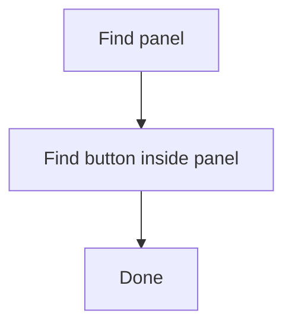
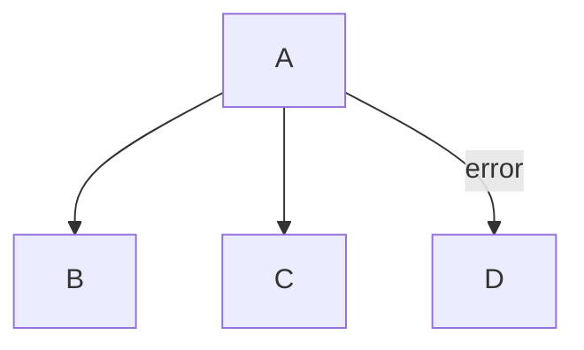
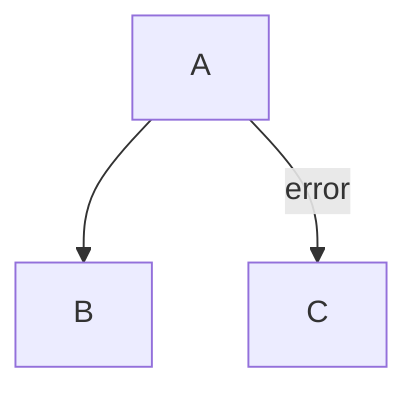
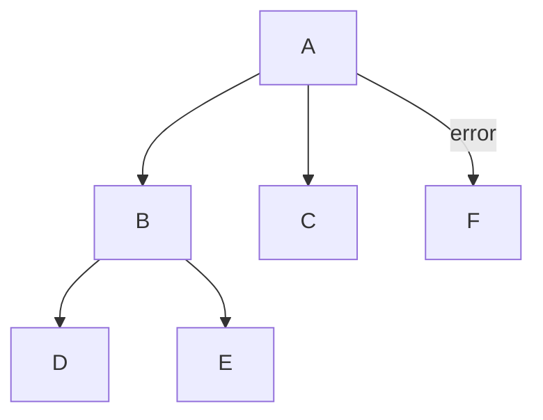
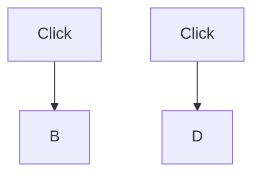
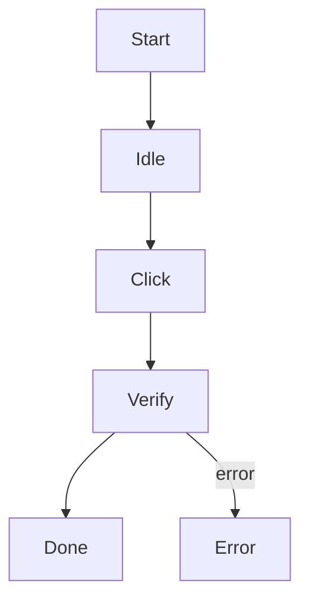

# Pipeline Meta JSON Format

This document defines the structure and all fields of `.meta.json` files used by the WatchDog pipeline engine.

## Overview

A pipeline consists of two required execution files and one optional presentation file:

| File | Purpose |
|------|---------|
| `<name>.md` | Mermaid flowchart — defines **topology** (nodes + edges) |
| `<name>.meta.json` | JSON — defines **properties** (recognition, actions, timing, etc.) |
| `<name>.layout.json` | JSON — optional shareable graph node positions; never affects execution |

The files reside together under `src-tauri/resources/pipelines/` (project-bundled) or `%USERPROFILE%\.watch_dog\resources\pipelines\` (user-created).

The engine merges Mermaid topology with `.meta.json` execution settings. Every Mermaid node must have a matching metadata entry. Keeping layout in a separate file prevents UI-only coordinates from cluttering or changing automation metadata.

Graph positions intentionally do not belong in `.meta.json`. See the [pipeline graph layout guide](pipeline-layout.md) for the adjacent `.layout.json` format, editor controls, and sharing behavior.

---

## Top-Level Structure

```json
{
  "target": {
    "type": "window",
    "title": "^Target UI - Login$",
    "capture_area": "client"
  },
  "launch": {
    "exe": "path/to/app.exe",
    "args": ["--login"],
    "wait_for_window": true
  },
  "nodes": {
    "<NodeName>": { ... },
    ...
  }
}
```

| Key | Type | Required | Default | Description |
|-----|------|----------|---------|-------------|
| `target` | `PipelineTarget` or `null` | No | `null` | Default target inherited by nodes; without one, pipeline execution reuses an active stream |
| `launch` | `LaunchConfig` or `null` | No | `null` | External process to start before pipeline execution |
| `nodes` | `object` | Yes | — | Map of node ID to node configuration |

---

## Target

The optional top-level `target` is the default capture source for the metadata file. A node may provide its own `target` override. Target resolution follows `node.target`, then the top-level `target`, then an already-active stream.

### Screen Target

Captures from a monitor by index.

```json
{ "type": "screen", "index": 0 }
```

| Field | Type | Required | Default | Description |
|-------|------|----------|---------|-------------|
| `type` | `"screen"` | Yes | — | Screen capture mode |
| `index` | `number` | No | `0` | Monitor index (0 = primary) |

### Window Target

Captures a specific window by matching its properties. The `process`, `class`, and `title` filters are optional and use **regex patterns** (consistent with OCR `expected`). When all three filters are omitted, the target inherits the currently active window; this form fails when no window stream is active.

```json
{ "type": "window", "process": "notepad" }
```

```json
{ "type": "window", "process": "chrome", "class": "Chrome_WidgetWin_1" }
```

```json
{ "type": "window", "title": "Calculator" }
```

Reuse the active window while changing only the captured area:

```json
{ "type": "window", "capture_area": "client" }
```

| Field | Type | Required | Default | Description |
|-------|------|----------|---------|-------------|
| `type` | `"window"` | Yes | — | Window capture mode |
| `process` | `string` | No | `null` | Process name regex (e.g. `"notepad"`, `"chrome"`) |
| `class` | `string` | No | `null` | Window class name regex (e.g. `"Notepad"`, `"Chrome_WidgetWin_1"`) |
| `title` | `string` | No | `null` | Window title regex (see examples below) |
| `capture_area` | `"frame"` or `"client"` | No | `"frame"` | Capture the complete window frame or only its client content |
| `window_size` | `[width, height]` | No | omitted | Expected client/content size in physical capture pixels. WatchDog attempts to establish this size before capture and reports the expected and actual sizes when the application rejects resizing |

`window_size` always describes the client area, even when `capture_area` is `"frame"`. It is supported only on the top-level target and is inherited by node target overrides. Both dimensions must be positive. Verification allows a two-pixel difference per dimension.

Window actions use global Windows mouse and keyboard input. Before capture,
WatchDog restores a minimized target and verifies that it became the foreground
window. Before every window action, it restores or activates the target again
if focus moved elsewhere, then verifies the foreground HWND. If Windows does
not grant foreground ownership, the node reports `target_not_foreground` and
sends no input to the other application.

### Optional VLM patrol

Patrol is an engine setting, not pipeline metadata. In Settings, configure the
OpenAI-compatible chat completions URL, vision model, and optional API key,
then turn on **Enable patrol**. The first validation starts after the configured
cycle (20 seconds by default). Later validations start after both the previous
VLM response and a full cycle since that request began; a response taking
longer than the cycle starts the next validation immediately. The VLM HTTP
request has a separate 120-second timeout. Recognition,
actions, and node routing continue independently. Patrol reports `aligned`,
`possible_mismatch`, or `inconclusive` in the Execution Log; a possible match is
advice for adjusting the pipeline and never selects or replays a node. A VLM
error or uncertain score leaves pipeline execution unchanged.

Patrol scores the current full capture frame against the expected node and its
K-hop neighbors, using node descriptions and any saved references. An
inconclusive local tier expands to 2K hops, including shared-parent siblings.
Each tier is limited to 16 candidates. After successful visits, a background
worker saves a clean, unannotated frame under
`%USERPROFILE%/.watch_dog/visions/patrol/<pipeline-hash>/<run-id>/`.
References are used only within the run that captured them, so a later run
cannot reuse stale screenshots. A new run uses descriptions until its own
references are available. Reference save failures are logged without failing
the pipeline. Turning off **Enable patrol** disables sampling and recording.

Settings also control K hops (1–4, default 1), match threshold (default 0.85),
and minimum score margin (default 0.1). Changes apply to the next run. Enablement,
search settings, URL, and model persist; the API key lasts only for the current
application session. A `patrol` field in `.meta.json` is rejected with a
diagnostic directing you to Settings. `get_pipeline_status` includes bounded
`patrol_state` evidence for captures, recognition results, action dispatches,
and reports. A sent action remains `unverified` until patrol matches a later
frame from the same target and session. Text input, key values, and custom
parameters are excluded from the ledger and VLM prompt.

```json
{
  "target": {
    "type": "window",
    "title": "^WatchDog Target$",
    "capture_area": "client",
    "window_size": [1280, 720]
  },
  "nodes": {}
}
```

If automatic resizing is rejected, pipeline execution does not start. The UI shows the required and current content sizes so the user can change the target application's own size setting and retry.

### Regex Examples

| Pattern | Matches |
|---------|---------|
| `"Untitled"` | Title is exactly "Untitled" |
| `".*Notepad"` | Title ends with "Notepad" |
| `"Calculator.*"` | Title starts with "Calculator" |
| `".*calc.*"` | Title contains "calc" (case-sensitive) |
| `"(?i).*calc.*"` | Title contains "calc" (case-insensitive) |

### Non-header Windows

Windows without title bars (embedded content, system trays) have empty titles. Use `process` + `class` to identify them:

```json
// Chrome embedded content
{ "type": "window", "process": "chrome", "class": "Chrome_RenderWidgetHostHWND" }

// System tray
{ "type": "window", "class": "Shell_TrayWnd" }

// Explorer file list
{ "type": "window", "process": "explorer", "class": "SysListView32" }
```

---

## Launch Configuration

The optional top-level `launch` field specifies an external process to start before pipeline execution. For a filtered window target, WatchDog first checks for an existing matching, live window and reuses it. It launches only when that target is absent, then resolves the window before resize, foreground, capture, or node execution. This prevents duplicate applications when the target is already open.

```json
{
  "launch": {
    "exe": "C:\\Program Files\\MyApp\\app.exe",
    "args": ["--login"],
    "wait_for_window": true,
    "wait_timeout_ms": 15000
  }
}
```

### Launch fields

| Field | Type | Required | Default | Description |
|-------|------|----------|---------|-------------|
| `exe` | `string` | No* | — | Path to executable. Mutually exclusive with `cmd` |
| `cmd` | `string` | No* | — | Command to run. Mutually exclusive with `exe` |
| `args` | `string[]` | No | `[]` | Arguments for the executable or command |
| `shell` | `boolean` | No | `false` | Run command in shell (`cmd.exe /C` on Windows). Only applies with `cmd` |
| `cwd` | `string` | No | inherited | Working directory for the process |
| `env` | `Record<string, string>` | No | `{}` | Environment variables for the process |
| `wait_for_window` | `boolean` | No | `false` | Wait for a window matching the pipeline target to appear |
| `wait_timeout_ms` | `number` | No | `10000` | Timeout in milliseconds to wait for window |

*Either `exe` or `cmd` must be provided.

`launch` with a window target requires at least one window identity filter: `process`, `class`, or `title`. A filterless window target has no identity to verify, so it can only reuse an already active window stream and cannot safely launch an application. For a normal application window, set `wait_for_window` to `true`; otherwise WatchDog does one immediate post-launch lookup and reports that the target is not ready if it has not appeared yet.

### Examples

**Launch executable with arguments:**

```json
{
  "launch": {
    "exe": "C:\\Program Files\\MyApp\\app.exe",
    "args": ["--login", "--debug"]
  }
}
```

**Run command in shell:**

```json
{
  "launch": {
    "cmd": "python server.py",
    "shell": true,
    "cwd": "C:\\MyApp"
  }
}
```

**Launch and wait for window:**

```json
{
  "launch": {
    "exe": "C:\\Program Files\\MyApp\\app.exe",
    "wait_for_window": true,
    "wait_timeout_ms": 15000
  }
}
```

---

## Node Fields

Each node entry in the `nodes` map has the following fields:

| Field | Type | Default | Description |
|-------|------|---------|-------------|
| `kind` | `"Normal"` \\| `"Entry"` \\| `"Endpoint"` | `"Normal"` | Structural node kind. Exactly one `Entry` and at least one `Endpoint` are required. |
| `desc` | `string` | `""` | Free-text description of what this node does. Display-only; the engine ignores it |
| `recognition` | `Recognition` | `{"type":"DirectHit"}` | How the engine detects this node on screen |
| `actions` | `Action[]` | `[]` | Actions to execute when the node is recognized |
| `target` | `PipelineTarget` or `null` | inherited | Optional capture target override; omitted or `null` inherits the top-level target. Declare `window_size` only on the top-level target |
| `timeout` | `u64` | `20000` | Quota shared by this node's children (ms). Candidates are tried round-robin until this quota is exhausted; the `timeout` in a child node is the quota for its own children |
| `error_timeout` | `u64` | `20000` | Quota for executing this node's error target (ms); progress keeps showing on this (parent) node |
| `rate_limit` | `u64` | `1000` | Minimum time between recognition attempts on this node (ms). When recognition fails, the engine waits at least this long before retrying |
| `pre_delay` | `u64` | `200` | Delay before executing actions (ms) |
| `pre_wait_freezes` | `u64` or object | `0` | Wait for consecutive stable frames before `pre_delay`; a fresh recognition runs after the delay and before input. Object fields: `time` (ms), `threshold` (default 0.98), `rate_limit` (default 200 ms), `timeout` (default 10000 ms), optional capture-local `roi` [x,y,width,height] |
| `post_delay` | `u64` | `200` | Delay after executing actions (ms) |
| `post_wait_freezes` | `u64` or object | `0` | Wait for stable frames after dispatched actions and before `post_delay` |
| `enabled` | `bool` | `true` | Whether this node is active — disabled nodes are skipped |
| `inverse` | `bool` | `false` | If `true`, the node matches when recognition **fails** |
| `max_hit` | `u32` | `4294967295` | Maximum number of times this node can be entered |
| `repeat` | `u32` | `1` | Number of times to repeat the complete ordered action list; must be at least 1 |
| `repeat_delay` | `u64` | `0` | Delay between action repeats (ms) |
| `attach` | `JSON` or `null` | `null` | Arbitrary data attached to the node (used by custom plugins) |

> **Note:** `params` and `param_values` are not valid in the `nodes` section. They belong in the `instances` section.

### Minimal node (all defaults)

```json
{}
```

Omitting `recognition` uses `DirectHit`. When developer tooling adds an action, its default type is `DoNothing`; omitting `actions` still means an empty action list.

### Fully specified node

```json
{
  "recognition": {
    "type": "TemplateMatch",
    "template": "Common/Confirm.png",
    "threshold": 0.9,
    "roi": [0, 0, 1920, 1080],
    "roi_offset": [0, 0, 0, 0]
  },
  "actions": [
    { "type": "Click", "target": true }
  ],
  "timeout": 15000,
  "rate_limit": 500,
  "pre_delay": 100,
  "post_delay": 300,
  "enabled": true,
  "inverse": false,
  "max_hit": 5,
  "repeat": 1,
  "repeat_delay": 0
}
```

---

## Recognition Types

The `recognition` field uses a **`type`** discriminator (internally tagged enum). All variants are listed below.

Every recognition type also accepts these common optional fields:

| Field | Type | Default | Description |
|-------|------|---------|-------------|
| `roi` | `[i32, i32, i32, i32]` or `"NodeId"` | `[0, 0, 0, 0]` | Fixed capture-local boundary or a prior node's recognized box; all zeros mean the full image |
| `roi_offset` | `[i32, i32, i32, i32]` | `[0, 0, 0, 0]` | Signed values added to the resolved ROI's x, y, width, and height before clipping |
| `candidate_selection` | `CandidateSelection` | `{"order":"native","index":0}` | Sort eligible candidates, then select a zero-based index; DirectHit, Entry and ColorMatch ignore it |

For nested recognition, use `"roi": "Find-Panel"` on a later node. `Find-Panel` must be an existing Mermaid node that matched and returned a box **earlier in the same run**; unknown and self-references fail pipeline validation. Mermaid node IDs may contain letters, digits, underscores, and hyphens, but must start with a letter or underscore. The engine maps the earlier node's screen-space box into the current captured frame, including frame/client changes on the same window. Referencing another window or monitor, a node with no successful box, or a non-overlapping mapped ROI fails recognition immediately with a diagnostic. That failure follows the node's normal error edge if one exists. Independent Node Test and Node Emulator runs cannot resolve earlier-node references.

`roi_offset` is always `[dx, dy, dwidth, dheight]`. The four values are added to x, y, width, and height **after** the fixed ROI or prior-node box resolves, then the result is clipped to the captured image. The all-zero fixed ROI `[0, 0, 0, 0]` alone means the full frame. Any other fixed ROI needs positive width and height.

For example, these two files recognize a button only inside a previously detected panel:

````markdown

````

```json
{
  "target": { "type": "window", "title": "^My Application$", "capture_area": "client" },
  "nodes": {
    "Find-Panel": {
      "recognition": { "type": "TemplateMatch", "template": "panel.png" }
    },
    "Find-Button": {
      "recognition": {
        "type": "TemplateMatch",
        "template": "button.png",
        "roi": "Find-Panel",
        "roi_offset": [0, 0, 0, 0]
      },
      "actions": [{ "type": "Click", "target": true }]
    },
    "Done": {}
  }
}
```

`candidate_selection.order` defaults to `"native"`; supported values are `native`, `top_to_bottom`, `bottom_to_top`, `left_to_right`, `right_to_left`, and `confidence_desc`. `candidate_selection.index` defaults to `0` and is applied after sorting.

### DirectHit

Always matches immediately. Used for normal nodes that do not need visual recognition.

```json
{ "type": "DirectHit" }
```

### Entry nodes (`kind`)

`Entry` is a structural **node kind**, not a recognition type. Declare it alongside the other node fields:

```json
{ "kind": "Entry", "timeout": 20000 }
```

An `Entry` node carries no recognition or actions — the engine transitions straight to its children (declaring `actions` on it fails validation with `entry_node_has_actions`). Its `timeout` is the quota for its children. Exactly one `Entry` node is **required** per pipeline: none fails with `missing_entry_node`, two or more with `invalid_entry_count`.

### Endpoint nodes (`kind`)

Declare one or more `Endpoint` nodes as successful destinations:

```json
{ "kind": "Endpoint" }
```

An `Endpoint` records a matched step and completes the run without capturing a frame, recognizing, or executing actions. It cannot have outgoing edges, recognition settings, or actions. A pipeline with no Endpoint fails loading with `missing_endpoint_node`. A successful normal node with no children fails the run with a non-Endpoint termination error; enabled Patrol attempts its final advisory check before failure status.

### TemplateMatch

Matches by comparing a template image against the screen using pixel-level difference (MSE). The template file path is relative to `resources/images/`.

| Field | Type | Required | Default | Description |
|-------|------|----------|---------|-------------|
| `type` | `"TemplateMatch"` | Yes | — | Discriminator |
| `template` | `string` | Yes | — | Path to template image (e.g. `"Common/Confirm.png"`) |
| `threshold` | `f64` | No | `0.7` | Minimum normalized similarity confidence (0.0–1.0) |

```json
{
  "type": "TemplateMatch",
  "template": "sample/button.png",
  "threshold": 0.85
}
```

### OCR

Matches by running PaddleOCR on the screen/ROI and comparing the recognized text against an expected pattern.

| Field | Type | Required | Default | Description |
|-------|------|----------|---------|-------------|
| `type` | `"OCR"` | Yes | — | Discriminator |
| `expected` | `string` | No | omitted | Expected text regex; omission accepts any text that passes the confidence threshold |
| `threshold` | `f64` | No | `0.3` | Minimum OCR confidence (0.0–1.0) |

When `expected` is provided, the node first tests each recognized text block
against the regex pattern. If no individual block matches, it tests the
smallest compact sequence of adjacent blocks. This allows a phrase wrapped
across multiple visual lines to produce one bounded candidate and click region;
text blocks spread across the screen are not merged. When `expected` is
`null`, any recognized text matches.

```json
{
  "type": "OCR",
  "expected": ".*確認.*",
  "threshold": 0.5
}
```

### ColorMatch

Matches if the average color within the ROI falls within the specified RGB range.

| Field | Type | Required | Default | Description |
|-------|------|----------|---------|-------------|
| `type` | `"ColorMatch"` | Yes | — | Discriminator |
| `lower` | `[u8, u8, u8]` | Yes | — | Lower RGB bound `[r, g, b]` |
| `upper` | `[u8, u8, u8]` | Yes | — | Upper RGB bound `[r, g, b]` |

```json
{
  "type": "ColorMatch",
  "lower": [200, 200, 200],
  "upper": [255, 255, 255]
}
```

### Custom

Delegates recognition to a user-defined Rust plugin registered in the `PluginRegistry`.

| Field | Type | Required | Default | Description |
|-------|------|----------|---------|-------------|
| `type` | `"Custom"` | Yes | — | Discriminator |
| `recognition` | `string` | Yes | — | Plugin name |
| `param` | `JSON` | No | `null` | Arbitrary parameters passed to the plugin |

```json
{
  "type": "Custom",
  "recognition": "MyRecognizer",
  "param": { "mode": "strict" }
}
```

---

## Action Types

The `actions` array contains action objects. Each action uses a **`type`** discriminator. Multiple actions per node are executed in order.

### DoNothing

No-op — does nothing. Useful as a placeholder or for nodes that only need recognition.

```json
{ "type": "DoNothing" }
```

### Click

Clicks at the specified target position.

| Field | Type | Required | Default | Description |
|-------|------|----------|---------|-------------|
| `type` | `"Click"` | Yes | — | Discriminator |
| `target` | `Target` | No | `true` | Where to click (see [Target](#target-enum)) |
| `target_offset` | `[i32, i32, i32, i32]` | No | `[0, 0, 0, 0]` | Offset applied to the resolved target position |

When `target` is `true`, clicks at the center of the recognized match region.

Action coordinates are capture-local pixels. Region targets execute at their
resolved center. After applying offsets, the engine requires that actual action
point to remain inside the encoded screen, window-frame, or window-client image.
The source region may cross an edge when its center remains valid. Out-of-bounds
action points fail immediately and are never silently clamped. Recognition ROIs
are different: a partially overlapping ROI is clipped, while an empty or
non-overlapping ROI fails.

```json
{ "type": "Click", "target": true }
```

```json
{ "type": "Click", "target": [500, 300] }
```

### LongPress

Presses and holds at the target position for the specified duration.

| Field | Type | Required | Default | Description |
|-------|------|----------|---------|-------------|
| `type` | `"LongPress"` | Yes | — | Discriminator |
| `target` | `Target` | No | `true` | Where to press |
| `target_offset` | `[i32, i32, i32, i32]` | No | `[0, 0, 0, 0]` | Offset applied to target |
| `duration` | `u64` | No | `1000` | Hold duration (ms) |

```json
{ "type": "LongPress", "target": true, "duration": 2000 }
```

### Swipe

Drags from `begin` to `end` position.

| Field | Type | Required | Default | Description |
|-------|------|----------|---------|-------------|
| `type` | `"Swipe"` | Yes | — | Discriminator |
| `begin` | `Target` | No | `true` | Start position |
| `begin_offset` | `[i32, i32, i32, i32]` | No | `[0, 0, 0, 0]` | Offset for start |
| `end` | `Target` | No | `true` | End position |
| `end_offset` | `[i32, i32, i32, i32]` | No | `[0, 0, 0, 0]` | Offset for end |
| `duration` | `u64` | No | `200` | Drag duration (ms) |

```json
{ "type": "Swipe", "begin": [100, 500], "end": [900, 500], "duration": 300 }
```

### Scroll

Scrolls by `dx`/`dy` at the target position.

| Field | Type | Required | Default | Description |
|-------|------|----------|---------|-------------|
| `type` | `"Scroll"` | Yes | — | Discriminator |
| `target` | `Target` | No | `true` | Where to scroll |
| `target_offset` | `[i32, i32, i32, i32]` | No | `[0, 0, 0, 0]` | Offset applied to target |
| `dx` | `i32` | No | `0` | Horizontal scroll amount |
| `dy` | `i32` | No | `0` | Vertical scroll amount (negative = up) |

```json
{ "type": "Scroll", "target": true, "dy": -300 }
```

### ClickKey

Presses one or more keyboard keys simultaneously.

| Field | Type | Required | Default | Description |
|-------|------|----------|---------|-------------|
| `type` | `"ClickKey"` | Yes | — | Discriminator |
| `key` | `u32[]` | Yes | — | List of key codes to press together |

Key codes are Windows virtual key codes (e.g. `0x0D` = Enter, `0x09` = Tab, `0x1B` = Escape).

```json
{ "type": "ClickKey", "key": [0x0D] }
```

```json
{ "type": "ClickKey", "key": [0x11, 0x53] }
```

### InputText

Types a text string.

| Field | Type | Required | Default | Description |
|-------|------|----------|---------|-------------|
| `type` | `"InputText"` | Yes | — | Discriminator |
| `input_text` | `string` | Yes | — | Text to type |

```json
{ "type": "InputText", "input_text": "Hello, World!" }
```

### StopTask

Stops the entire pipeline execution immediately.

```json
{ "type": "StopTask" }
```

### Custom

Delegates action to a user-defined Rust plugin registered in the `PluginRegistry`.

| Field | Type | Required | Default | Description |
|-------|------|----------|---------|-------------|
| `type` | `"Custom"` | Yes | — | Discriminator |
| `action` | `string` | Yes | — | Plugin name |
| `param` | `JSON` | No | `null` | Arbitrary parameters passed to the plugin |

```json
{
  "type": "Custom",
  "action": "SerialCommand",
  "param": { "port": "COM3", "baud": 9600, "command": "LED_ON" }
}
```

---

## Node Test Parameters

Each object in `params` describes one developer-editable field shown by Node Test.

| Field | Type | Required | Default | Description |
|-------|------|----------|---------|-------------|
| `type` | `text`, `password`, `number`, `dropdown`, `switch`, or `color` | Yes | — | Input control type |
| `key` | `string` | Yes | — | Placeholder name used as `{{key}}` |
| `label` | `string` | Yes | — | Human-readable input label |
| `placeholder` | `string` | No | `""` | Hint shown while the input is empty |
| `default` | `JSON` | No | `null` | Initial value appropriate for the selected input type |
| `options` | `string[]` | No | `[]` | Dropdown choices; ignored by other input types |

---

## Target Enum

The `target` field in Click/LongPress/Swipe/Scroll actions uses an **untagged** enum. Serde tries each variant in order:

| Variant | JSON Format | Description |
|---------|-------------|-------------|
| `RecognizedBool` | `true` | Use the center of the current recognized match region (most common and the default). `false` is not a usable action target and causes action validation/execution to fail |
| `Coordinate` | `[x, y]` | Absolute screen/window coordinates |
| `Region` | `[x, y, w, h]` | Region — uses center of this region |
| `Node` | `"NodeName"` | Reference to another node — uses that node's last recognized position |

### Examples

```json
true
```

```json
[500, 300]
```

```json
[100, 200, 400, 300]
```

```json
"ButtonNode"
```

---

## Edge Types

Edge types are defined in the Mermaid file, not in the meta JSON:

- `-->` — Normal transition (`"next"`). Followed when the source node succeeds.
- `-->|error|` or `-.->` — Error transition (`"error"`). Followed when the source node fails.

### Children (Switch Nodes)

Every node carries a children list (`n >= 0` outgoing `-->` edges). `n == 0` completes only at an `Endpoint`; at any other node it fails the run. `n >= 1` tries the children round-robin against the parent's timeout quota. There is no separate single-next path — `n == 1` re-selects the only child every round:

1. After the source node succeeds (recognition + actions), the engine collects all `-->` targets as candidates
2. Round-robin through candidates: one recognition attempt per round
3. First candidate that matches wins → execute its actions → follow its path
4. The source node's `timeout` is a **shared quota** for all candidates
5. When the quota is exhausted, the source node's `-->|error|` edge runs under the `error_timeout` quota with progress kept on the source node (or the run fails if no error edge exists)

Multiple candidates example:


- A succeeds → try B → try C → try B → try C → ... (round-robin)
- If B matches → execute B's actions → follow B's edge
- If C matches → execute C's actions → follow C's edge
- If all timeout → follow A's error edge → D

Single candidate example:


- A succeeds → try B
- If B matches → execute B's actions → follow B's edge
- If B timeout → follow A's error edge → C (not B's error edge)

#### Candidate Skipping

Candidates that are disabled or have reached `max_hit` are skipped in the rotation. Both cases produce a `StepResult` with `skipped: true` so the frontend can display the skip event:

```typescript
{
  node_id: "B",
  matched: true,      // true because the node would have matched if active
  confidence: 0.0,
  box_region: null,
  actions_fired: 0,
  skipped: true,      // indicates this candidate was skipped
  duration_ms: 0,
  error: null
}
```

#### Recursive children

When a matched candidate itself has one or more `-->` edges, the engine clears the current children state and starts trying the new candidates. This allows nested decision trees:



- A succeeds → children: try B, C
- B matches → B's actions execute → B has children: try D, E
- If D matches → D's actions execute → follow D's edge
- If E matches → E's actions execute → follow E's edge
- If B's candidates timeout → follow B's error edge (if defined)

Note: Each level of children uses its own parent's timeout quota.

---

## Node Label vs ID (Config Lookup)

Meta.json keys match node **labels**, not node IDs. This is a breaking change from the previous ID-based lookup.

### How it works

When the engine builds the graph, it looks up each node's config in meta.json using the node's **label** (from the Mermaid flowchart). If the label is empty, it falls back to the node ID.



```json
{
  "nodes": {
    "Click": {
      "recognition": { "type": "TemplateMatch", "template": "button.png" },
      "actions": [{ "type": "Click", "target": true }],
      "max_hit": 2
    }
  }
}
```

In this example:
- Node `A` has label `"Click"` → gets config from `meta.json.nodes["Click"]`
- Node `C` has label `"Click"` → also gets config from `meta.json.nodes["Click"]`
- Both nodes share the same recognition, actions, and timing settings
- Each node has its own independent `hit_counts` entry (keyed by node ID, not label)

### When ID = label

If your Mermaid node ID matches the label (e.g., `Click["Click"]`), behavior is identical to the previous ID-based lookup. This is the common case.

### When ID ≠ label

If you use different IDs and labels (e.g., `A["Click"]`), meta.json must have an entry for `"Click"` (the label), not `"A"` (the ID). The validation checks labels against meta.json keys.

### Node instances

Each node ID in the Mermaid flowchart is a unique instance, even if multiple nodes share the same label. The engine tracks per-instance state:
- `hit_counts[node_id]` — how many times this specific node matched
- `max_hit` — limits matches per instance (not per label)

---

## Node Templates and Instances

The `instances` field in meta.json allows you to define reusable node behavior templates and create multiple instances of them with per-instance overrides.

### How it works

1. Define node templates in the `nodes` section (behavior, recognition, actions, timing)
2. Map Mermaid node IDs to templates in the `instances` section
3. Define parameters and parameter values per instance

**Priority order**: Instance lookup → Label-based lookup → Default

```json
{
  "nodes": {
    "Click": {
      "recognition": { "type": "TemplateMatch", "template": "button.png" },
      "actions": [{ "type": "Click", "target": true }]
    }
  },
  "instances": {
    "A": {
      "node": "Click",
      "params": [
        { "key": "button_name", "type": "string", "required": false, "default": "Button" }
      ],
      "param_values": { "button_name": "Submit" }
    },
    "B": {
      "node": "Click",
      "params": [
        { "key": "button_name", "type": "string", "required": false, "default": "Button" }
      ],
      "param_values": { "button_name": "Cancel" },
      "timeout": 5000
    }
  }
}
```

In this example:
- Node `A` gets config from template `"Click"` with `button_name` = `"Submit"`
- Node `B` gets config from template `"Click"` with `button_name` = `"Cancel"` and a custom timeout
- If neither `A` nor `B` appear in `instances`, the engine falls back to label-based lookup

### Instance fields

| Field | Type | Required | Default | Description |
|-------|------|----------|---------|-------------|
| `node` | `string` | Yes | — | Reference to a node template in the `nodes` section |
| `kind` | `string` | No | Template's value | Override structural node kind (`Normal` \\| `Entry` \\| `Endpoint`) |
| `desc` | `string` | No | Template's value | Override free-text description |
| `params` | `ParamDef[]` | No | `[]` | Parameter definitions for this instance |
| `param_values` | `Record<string, unknown>` | No | `{}` | Default values for parameters |
| `timeout` | `number` | No | Template's value | Override children-quota timeout (ms) |
| `error_timeout` | `number` | No | Template's value | Override error-target quota (ms) |
| `rate_limit` | `number` | No | Template's value | Override rate limit (ms) |
| `pre_delay` | `number` | No | Template's value | Override pre-delay (ms) |
| `pre_wait_freezes` | `number` or object | No | Template's value | Override pre-action stable-frame wait |
| `post_delay` | `number` | No | Template's value | Override post-delay (ms) |
| `post_wait_freezes` | `number` or object | No | Template's value | Override post-action stable-frame wait |
| `enabled` | `boolean` | No | Template's value | Override enabled state |
| `inverse` | `boolean` | No | Template's value | Override inverse state |
| `max_hit` | `number` | No | Template's value | Override max hit count |
| `repeat` | `number` | No | Template's value | Override repeat count |
| `repeat_delay` | `number` | No | Template's value | Override repeat delay (ms) |

### Validation

- Instance `node` references must point to existing templates in the `nodes` section
- Mermaid nodes not in `instances` must have their label (or ID if label is empty) in `nodes`

---

## Runtime Node Instance Model

During pipeline execution, the engine tracks per-node state. The frontend polls this state to display runtime information.

### State tracked per node

| State | Source | Description |
|-------|--------|-------------|
| `hit_counts` | Backend `PipelineStatus` | Map of `node_id → match_count` |
| `current_node_id` | Backend `PipelineStatus` | Which node is currently executing |
| `step_count` | Backend `PipelineStatus` | Total steps completed |
| `elapsed_ms` | Backend `PipelineStatus` | Total pipeline elapsed time |
| `nodeElapsedMs` | Frontend store | Time spent on current node (approximate) |
| `childrenParentId` | Frontend store | Parent node ID while its children are tried |
| `childrenStartTime` | Frontend store | When children trying started (for timeout calculation) |
| `childrenChildId` | Frontend store | Child node currently executing |
| `childrenTimeoutMs` | Frontend store | Active quota (parent `timeout`, or `error_timeout` for error targets) |
| `lastStepResults` | Frontend store | Last 10 `StepResult` entries |

### StepResult structure

Each node execution produces a `StepResult`:

```typescript
interface StepResult {
  node_id: string;        // Which node executed
  matched: boolean;       // Whether recognition succeeded
  confidence: number;     // Match confidence (0.0-1.0)
  box_region: Region | null;  // Recognized region (screen coords)
  actions_fired: number;  // How many actions executed
  skipped?: boolean;      // Skipped due to max_hit or disabled
  duration_ms: number;    // Time spent on this node
  error: string | null;   // Error message if failed
  timings_ms?: Record<string, number>;  // Detailed phase timings
}
```

### Children trying (backend state, formerly heuristic)

The backend reports the children-trying state on every status update. When this state is present:
- `childrenParentId` is the parent node whose children are tried
- `childrenStartTime` records when trying began
- `childrenChildId` is the child currently executing (highlighted)
- Progress bar shows on the parent using the active quota (`childrenTimeoutMs`)

### Detailed timings

When `detailed_timings` is enabled, `timings_ms` includes phase breakdowns:
- `pipeline_startup` — graph parsing, validation, stream setup
- `frame_acquire` — time to capture a frame
- `recognition` — recognition evaluation
- `coordinate` — coordinate mapping
- `pre_wait_freezes`, `pre_delay`, `actions`, `post_wait_freezes`, `post_delay` — action phases
- `debug_image` — debug image generation

---

## Complete Example

### sample.md

````

````

### sample.meta.json

```json
{
  "nodes": {
    "Start": {
      "kind": "Entry",
      "timeout": 20000
    },
    "Idle": {
      "recognition": {
        "type": "TemplateMatch",
        "template": "sample/idle.png",
        "threshold": 0.8
      },
      "actions": [
        { "type": "DoNothing" }
      ],
      "timeout": 20000,
      "rate_limit": 1000,
      "pre_delay": 200,
      "post_delay": 200,
      "enabled": true,
      "inverse": false,
      "max_hit": 1
    },
    "Click": {
      "recognition": {
        "type": "TemplateMatch",
        "template": "sample/button.png",
        "threshold": 0.9
      },
      "actions": [
        { "type": "Click", "target": true }
      ],
      "timeout": 20000,
      "rate_limit": 1000,
      "pre_delay": 200,
      "post_delay": 500,
      "enabled": true,
      "inverse": false,
      "max_hit": 1
    },
    "Verify": {
      "recognition": {
        "type": "TemplateMatch",
        "template": "sample/success.png",
        "threshold": 0.9
      },
      "actions": [
        { "type": "DoNothing" }
      ],
      "timeout": 30000,
      "rate_limit": 1000,
      "pre_delay": 200,
      "post_delay": 200,
      "enabled": true,
      "inverse": false,
      "max_hit": 3
    },
    "Done": {
      "kind": "Endpoint",
      "enabled": true,
      "max_hit": 1
    },
    "Error": {
      "recognition": { "type": "DirectHit" },
      "actions": [
        { "type": "DoNothing" }
      ],
      "enabled": true,
      "max_hit": 1
    }
  }
}
```

### Optional sample.layout.json

```json
{
  "nodes": {
    "Idle": { "x": 100, "y": 40 },
    "Click": { "x": 100, "y": 140 },
    "Verify": { "x": 100, "y": 240 },
    "Done": { "x": 20, "y": 340 },
    "Error": { "x": 180, "y": 340 }
  }
}
```

This optional file affects only graph presentation. See [Pipeline graph layout](pipeline-layout.md) for its complete contract.

---

## Minimal Example

The smallest valid meta.json. All omitted fields use their defaults.

```json
{
  "nodes": {
    "Test": {
      "recognition": { "type": "DirectHit" }
    }
  }
}
```

---

## Default Values Reference

| Field | Constant | Value | Notes |
|-------|----------|-------|-------|
| `timeout` | `DEFAULT_TIMEOUT_MS` | `20000` | Quota shared by the node's children |
| `kind` | — | `"Normal"` | Structural node kind; exactly one `"Entry"` and at least one `"Endpoint"` required |
| `desc` | — | `""` | Display-only description |
| `error_timeout` | `DEFAULT_TIMEOUT_MS` | `20000` | Quota for the node's error target |
| `rate_limit` | `DEFAULT_RATE_LIMIT_MS` | `1000` | Wait time between failed recognition retries |
| `pre_delay` | `DEFAULT_PRE_DELAY_MS` | `200` | |
| `post_delay` | `DEFAULT_POST_DELAY_MS` | `200` | |
| `max_hit` | `DEFAULT_MAX_HIT` | `4294967295` (u32::MAX) | |
| `repeat` | `DEFAULT_REPEAT` | `1` | |
| `repeat_delay` | `DEFAULT_REPEAT_DELAY_MS` | `0` | |
| `enabled` | — | `true` | |
| `inverse` | — | `false` | |
| `recognition` | — | `{"type":"DirectHit"}` | |
| `actions` | — | `[]` | |
| new action `type` | — | `"DoNothing"` | Default selection when adding an action; an explicit action object still requires `type` |
| `params` | — | `[]` | |
| top-level `target` | — | `null` | Reuse an active stream when no target is declared |
| screen `index` | — | `0` | |
| window `capture_area` | — | `"frame"` | |
| window filters / `window_size` | — | omitted | No filtering field or size preflight |
| `roi` | — | `[0, 0, 0, 0]` | Complete captured image |
| `roi_offset` | — | `[0, 0, 0, 0]` | |
| `candidate_selection` | — | `{"order":"native","index":0}` | |
| `threshold` (TemplateMatch) | — | `0.7` | |
| `expected` (OCR) | — | omitted | No text-pattern filter |
| `threshold` (OCR) | — | `0.3` | |
| `target` (in actions) | — | `true` | |
| action target offsets | — | `[0, 0, 0, 0]` | `target_offset`, `begin_offset`, and `end_offset` |
| `duration` (LongPress) | — | `1000` | |
| `duration` (Swipe) | — | `200` | |
| `dx` / `dy` (Scroll) | — | `0` | |
| custom recognition/action `param` | — | `null` | |
| parameter `placeholder` | — | `""` | |
| parameter `default` | — | `null` | |
| parameter `options` | — | `[]` | |
| node `attach` | — | `null` | |
| `edge_type` | — | `"next"` | |
Threshold-passing positions commonly overlap by only one or two pixels. The
engine merges those positions using overlap suppression before applying
`candidate_selection`. Candidate indexes therefore identify distinct detected
objects rather than every pixel-shift variation. Debug results report both the
raw and distinct counts, and saved images limit candidate overlays so the
capture remains readable.
