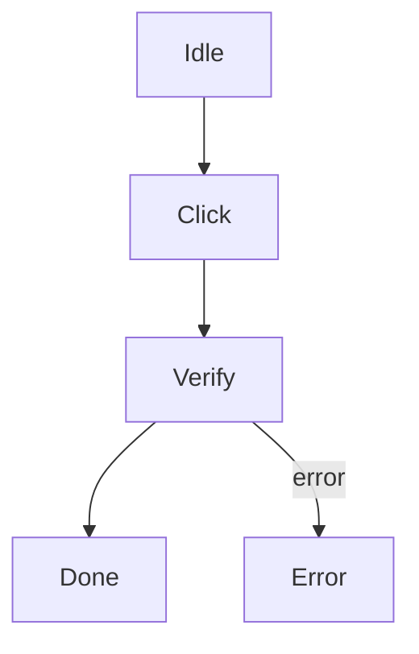

# Pipeline Meta JSON Format

This document defines the structure and all fields of `.meta.json` files used by the WatchDog pipeline engine.

## Overview

A pipeline consists of two required execution files and one optional presentation file:

| File | Purpose |
|------|---------|
| `<name>.md` | Mermaid flowchart — defines **topology** (nodes + edges) |
| `<name>.meta.json` | JSON — defines **properties** (recognition, actions, timing, etc.) |
| `<name>.layout.json` | JSON — optional shareable graph node positions; never affects execution |

The files reside together under `src-tauri/resources/pipelines/` (project-bundled) or `%USERPROFILE%\.watch_dog\resources\pipelines\` (user-created).

The engine merges Mermaid topology with `.meta.json` execution settings. Every Mermaid node must have a matching metadata entry. Keeping layout in a separate file prevents UI-only coordinates from cluttering or changing automation metadata.

Graph positions intentionally do not belong in `.meta.json`. See the [pipeline graph layout guide](pipeline-layout.md) for the adjacent `.layout.json` format, editor controls, and sharing behavior.

---

## Top-Level Structure

```json
{
  "target": {
    "type": "window",
    "title": "^Target UI - Login$",
    "capture_area": "client"
  },
  "nodes": {
    "<NodeName>": { ... },
    ...
  },
  "edges": {
    "<FromNode>-><ToNode>": { ... },
    ...
  }
}
```

| Key | Type | Required | Default | Description |
|-----|------|----------|---------|-------------|
| `target` | `PipelineTarget` or `null` | No | `null` | Default target inherited by nodes; without one, pipeline execution reuses an active stream |
| `nodes` | `object` | Yes | — | Map of node ID to node configuration |
| `edges` | `object` | No | `{}` | Map of `"From->To"` to edge configuration |

Edge keys use the format `"SourceNode->TargetNode"`. For error edges, the edge type is specified in the value, not the key.

---

## Target

The optional top-level `target` is the default capture source for the metadata file. A node may provide its own `target` override. Target resolution follows `node.target`, then the top-level `target`, then an already-active stream.

### Screen Target

Captures from a monitor by index.

```json
{ "type": "screen", "index": 0 }
```

| Field | Type | Required | Default | Description |
|-------|------|----------|---------|-------------|
| `type` | `"screen"` | Yes | — | Screen capture mode |
| `index` | `number` | No | `0` | Monitor index (0 = primary) |

### Window Target

Captures a specific window by matching its properties. The `process`, `class`, and `title` filters are optional and use **regex patterns** (consistent with OCR `expected`). When all three filters are omitted, the target inherits the currently active window; this form fails when no window stream is active.

```json
{ "type": "window", "process": "notepad" }
```

```json
{ "type": "window", "process": "chrome", "class": "Chrome_WidgetWin_1" }
```

```json
{ "type": "window", "title": "Calculator" }
```

Reuse the active window while changing only the captured area:

```json
{ "type": "window", "capture_area": "client" }
```

| Field | Type | Required | Default | Description |
|-------|------|----------|---------|-------------|
| `type` | `"window"` | Yes | — | Window capture mode |
| `process` | `string` | No | `null` | Process name regex (e.g. `"notepad"`, `"chrome"`) |
| `class` | `string` | No | `null` | Window class name regex (e.g. `"Notepad"`, `"Chrome_WidgetWin_1"`) |
| `title` | `string` | No | `null` | Window title regex (see examples below) |
| `capture_area` | `"frame"` or `"client"` | No | `"frame"` | Capture the complete window frame or only its client content |
| `window_size` | `[width, height]` | No | omitted | Expected client/content size in physical capture pixels. WatchDog attempts to establish this size before capture and reports the expected and actual sizes when the application rejects resizing |

`window_size` always describes the client area, even when `capture_area` is `"frame"`. It is supported only on the top-level target and is inherited by node target overrides. Both dimensions must be positive. Verification allows a two-pixel difference per dimension.

Window actions use global Windows mouse and keyboard input. Before capture,
WatchDog restores a minimized target and verifies that it became the foreground
window. It checks the foreground HWND again immediately before every action. If
focus moved elsewhere, the node fails with `target_not_foreground` and sends no
input to the other application.

```json
{
  "target": {
    "type": "window",
    "title": "^WatchDog Target$",
    "capture_area": "client",
    "window_size": [1280, 720]
  },
  "nodes": {},
  "edges": {}
}
```

If automatic resizing is rejected, pipeline execution does not start. The UI shows the required and current content sizes so the user can change the target application's own size setting and retry.

### Regex Examples

| Pattern | Matches |
|---------|---------|
| `"Untitled"` | Title is exactly "Untitled" |
| `".*Notepad"` | Title ends with "Notepad" |
| `"Calculator.*"` | Title starts with "Calculator" |
| `".*calc.*"` | Title contains "calc" (case-sensitive) |
| `"(?i).*calc.*"` | Title contains "calc" (case-insensitive) |

### Non-header Windows

Windows without title bars (embedded content, system trays) have empty titles. Use `process` + `class` to identify them:

```json
// Chrome embedded content
{ "type": "window", "process": "chrome", "class": "Chrome_RenderWidgetHostHWND" }

// System tray
{ "type": "window", "class": "Shell_TrayWnd" }

// Explorer file list
{ "type": "window", "process": "explorer", "class": "SysListView32" }
```

---

## Node Fields

Each node entry in the `nodes` map has the following fields:

| Field | Type | Default | Description |
|-------|------|---------|-------------|
| `recognition` | `Recognition` | `{"type":"DirectHit"}` | How the engine detects this node on screen |
| `actions` | `Action[]` | `[]` | Actions to execute when the node is recognized |
| `params` | `Parameter[]` | `[]` | Developer-editable fields shown by Node Test; values can be referenced as `{{key}}` in supported action strings |
| `target` | `PipelineTarget` or `null` | inherited | Optional capture target override; omitted or `null` inherits the top-level target. Declare `window_size` only on the top-level target |
| `timeout` | `u64` | `20000` | Maximum time to wait for recognition (ms) |
| `rate_limit` | `u64` | `1000` | Minimum time between recognition attempts on this node (ms). When recognition fails, the engine waits at least this long before retrying |
| `pre_delay` | `u64` | `200` | Delay before executing actions (ms) |
| `post_delay` | `u64` | `200` | Delay after executing actions (ms) |
| `enabled` | `bool` | `true` | Whether this node is active — disabled nodes are skipped |
| `inverse` | `bool` | `false` | If `true`, the node matches when recognition **fails** |
| `max_hit` | `u32` | `4294967295` | Maximum number of times this node can be entered |
| `repeat` | `u32` | `1` | Number of times to repeat the complete ordered action list; must be at least 1 |
| `repeat_delay` | `u64` | `0` | Delay between action repeats (ms) |
| `attach` | `JSON` or `null` | `null` | Arbitrary data attached to the node (used by custom plugins) |

### Minimal node (all defaults)

```json
{}
```

Omitting `recognition` uses `DirectHit`. When developer tooling adds an action, its default type is `DoNothing`; omitting `actions` still means an empty action list.

### Fully specified node

```json
{
  "recognition": {
    "type": "TemplateMatch",
    "template": "Common/Confirm.png",
    "threshold": 0.9,
    "roi": [0, 0, 1920, 1080],
    "roi_offset": [0, 0, 0, 0]
  },
  "actions": [
    { "type": "Click", "target": true }
  ],
  "timeout": 15000,
  "rate_limit": 500,
  "pre_delay": 100,
  "post_delay": 300,
  "enabled": true,
  "inverse": false,
  "max_hit": 5,
  "repeat": 1,
  "repeat_delay": 0
}
```

---

## Recognition Types

The `recognition` field uses a **`type`** discriminator (internally tagged enum). All variants are listed below.

Every recognition type also accepts these common optional fields:

| Field | Type | Default | Description |
|-------|------|---------|-------------|
| `roi` | `[i32, i32, i32, i32]` | `[0, 0, 0, 0]` | Recognition boundary; the all-zero value means the complete captured image |
| `roi_offset` | `[i32, i32, i32, i32]` | `[0, 0, 0, 0]` | Offset added to the ROI before recognition |
| `candidate_selection` | `CandidateSelection` | `{"order":"native","index":0}` | Sort eligible candidates, then select a zero-based index; DirectHit and ColorMatch ignore it |

`candidate_selection.order` defaults to `"native"`; supported values are `native`, `top_to_bottom`, `bottom_to_top`, `left_to_right`, `right_to_left`, and `confidence_desc`. `candidate_selection.index` defaults to `0` and is applied after sorting.

### DirectHit

Always matches immediately. Used for terminal nodes, error nodes, or nodes that don't need visual recognition.

```json
{ "type": "DirectHit" }
```

### TemplateMatch

Matches by comparing a template image against the screen using pixel-level difference (MSE). The template file path is relative to `resources/images/`.

| Field | Type | Required | Default | Description |
|-------|------|----------|---------|-------------|
| `type` | `"TemplateMatch"` | Yes | — | Discriminator |
| `template` | `string` | Yes | — | Path to template image (e.g. `"Common/Confirm.png"`) |
| `threshold` | `f64` | No | `0.7` | Minimum normalized similarity confidence (0.0–1.0) |

```json
{
  "type": "TemplateMatch",
  "template": "sample/button.png",
  "threshold": 0.85
}
```

### OCR

Matches by running PaddleOCR on the screen/ROI and comparing the recognized text against an expected pattern.

| Field | Type | Required | Default | Description |
|-------|------|----------|---------|-------------|
| `type` | `"OCR"` | Yes | — | Discriminator |
| `expected` | `string` | No | omitted | Expected text regex; omission accepts any text that passes the confidence threshold |
| `threshold` | `f64` | No | `0.3` | Minimum OCR confidence (0.0–1.0) |

When `expected` is provided, the node matches if the recognized text matches the regex pattern. When `expected` is `null`, any recognized text matches.

```json
{
  "type": "OCR",
  "expected": ".*確認.*",
  "threshold": 0.5
}
```

### ColorMatch

Matches if the average color within the ROI falls within the specified RGB range.

| Field | Type | Required | Default | Description |
|-------|------|----------|---------|-------------|
| `type` | `"ColorMatch"` | Yes | — | Discriminator |
| `lower` | `[u8, u8, u8]` | Yes | — | Lower RGB bound `[r, g, b]` |
| `upper` | `[u8, u8, u8]` | Yes | — | Upper RGB bound `[r, g, b]` |

```json
{
  "type": "ColorMatch",
  "lower": [200, 200, 200],
  "upper": [255, 255, 255]
}
```

### Custom

Delegates recognition to a user-defined Rust plugin registered in the `PluginRegistry`.

| Field | Type | Required | Default | Description |
|-------|------|----------|---------|-------------|
| `type` | `"Custom"` | Yes | — | Discriminator |
| `recognition` | `string` | Yes | — | Plugin name |
| `param` | `JSON` | No | `null` | Arbitrary parameters passed to the plugin |

```json
{
  "type": "Custom",
  "recognition": "MyRecognizer",
  "param": { "mode": "strict" }
}
```

---

## Action Types

The `actions` array contains action objects. Each action uses a **`type`** discriminator. Multiple actions per node are executed in order.

### DoNothing

No-op — does nothing. Useful as a placeholder or for nodes that only need recognition.

```json
{ "type": "DoNothing" }
```

### Click

Clicks at the specified target position.

| Field | Type | Required | Default | Description |
|-------|------|----------|---------|-------------|
| `type` | `"Click"` | Yes | — | Discriminator |
| `target` | `Target` | No | `true` | Where to click (see [Target](#target-enum)) |
| `target_offset` | `[i32, i32, i32, i32]` | No | `[0, 0, 0, 0]` | Offset applied to the resolved target position |

When `target` is `true`, clicks at the center of the recognized match region.

Action coordinates are capture-local pixels. Region targets execute at their
resolved center. After applying offsets, the engine requires that actual action
point to remain inside the encoded screen, window-frame, or window-client image.
The source region may cross an edge when its center remains valid. Out-of-bounds
action points fail immediately and are never silently clamped. Recognition ROIs
are different: a partially overlapping ROI is clipped, while an empty or
non-overlapping ROI fails.

```json
{ "type": "Click", "target": true }
```

```json
{ "type": "Click", "target": [500, 300] }
```

### LongPress

Presses and holds at the target position for the specified duration.

| Field | Type | Required | Default | Description |
|-------|------|----------|---------|-------------|
| `type` | `"LongPress"` | Yes | — | Discriminator |
| `target` | `Target` | No | `true` | Where to press |
| `target_offset` | `[i32, i32, i32, i32]` | No | `[0, 0, 0, 0]` | Offset applied to target |
| `duration` | `u64` | No | `1000` | Hold duration (ms) |

```json
{ "type": "LongPress", "target": true, "duration": 2000 }
```

### Swipe

Drags from `begin` to `end` position.

| Field | Type | Required | Default | Description |
|-------|------|----------|---------|-------------|
| `type` | `"Swipe"` | Yes | — | Discriminator |
| `begin` | `Target` | No | `true` | Start position |
| `begin_offset` | `[i32, i32, i32, i32]` | No | `[0, 0, 0, 0]` | Offset for start |
| `end` | `Target` | No | `true` | End position |
| `end_offset` | `[i32, i32, i32, i32]` | No | `[0, 0, 0, 0]` | Offset for end |
| `duration` | `u64` | No | `200` | Drag duration (ms) |

```json
{ "type": "Swipe", "begin": [100, 500], "end": [900, 500], "duration": 300 }
```

### Scroll

Scrolls by `dx`/`dy` at the target position.

| Field | Type | Required | Default | Description |
|-------|------|----------|---------|-------------|
| `type` | `"Scroll"` | Yes | — | Discriminator |
| `target` | `Target` | No | `true` | Where to scroll |
| `target_offset` | `[i32, i32, i32, i32]` | No | `[0, 0, 0, 0]` | Offset applied to target |
| `dx` | `i32` | No | `0` | Horizontal scroll amount |
| `dy` | `i32` | No | `0` | Vertical scroll amount (negative = up) |

```json
{ "type": "Scroll", "target": true, "dy": -300 }
```

### ClickKey

Presses one or more keyboard keys simultaneously.

| Field | Type | Required | Default | Description |
|-------|------|----------|---------|-------------|
| `type` | `"ClickKey"` | Yes | — | Discriminator |
| `key` | `u32[]` | Yes | — | List of key codes to press together |

Key codes are Windows virtual key codes (e.g. `0x0D` = Enter, `0x09` = Tab, `0x1B` = Escape).

```json
{ "type": "ClickKey", "key": [0x0D] }
```

```json
{ "type": "ClickKey", "key": [0x11, 0x53] }
```

### InputText

Types a text string.

| Field | Type | Required | Default | Description |
|-------|------|----------|---------|-------------|
| `type` | `"InputText"` | Yes | — | Discriminator |
| `input_text` | `string` | Yes | — | Text to type |

```json
{ "type": "InputText", "input_text": "Hello, World!" }
```

### StopTask

Stops the entire pipeline execution immediately.

```json
{ "type": "StopTask" }
```

### Custom

Delegates action to a user-defined Rust plugin registered in the `PluginRegistry`.

| Field | Type | Required | Default | Description |
|-------|------|----------|---------|-------------|
| `type` | `"Custom"` | Yes | — | Discriminator |
| `action` | `string` | Yes | — | Plugin name |
| `param` | `JSON` | No | `null` | Arbitrary parameters passed to the plugin |

```json
{
  "type": "Custom",
  "action": "SerialCommand",
  "param": { "port": "COM3", "baud": 9600, "command": "LED_ON" }
}
```

---

## Node Test Parameters

Each object in `params` describes one developer-editable field shown by Node Test.

| Field | Type | Required | Default | Description |
|-------|------|----------|---------|-------------|
| `type` | `text`, `password`, `number`, `dropdown`, `switch`, or `color` | Yes | — | Input control type |
| `key` | `string` | Yes | — | Placeholder name used as `{{key}}` |
| `label` | `string` | Yes | — | Human-readable input label |
| `placeholder` | `string` | No | `""` | Hint shown while the input is empty |
| `default` | `JSON` | No | `null` | Initial value appropriate for the selected input type |
| `options` | `string[]` | No | `[]` | Dropdown choices; ignored by other input types |

---

## Target Enum

The `target` field in Click/LongPress/Swipe/Scroll actions uses an **untagged** enum. Serde tries each variant in order:

| Variant | JSON Format | Description |
|---------|-------------|-------------|
| `RecognizedBool` | `true` | Use the center of the current recognized match region (most common and the default). `false` is not a usable action target and causes action validation/execution to fail |
| `Coordinate` | `[x, y]` | Absolute screen/window coordinates |
| `Region` | `[x, y, w, h]` | Region — uses center of this region |
| `Node` | `"NodeName"` | Reference to another node — uses that node's last recognized position |

### Examples

```json
true
```

```json
[500, 300]
```

```json
[100, 200, 400, 300]
```

```json
"ButtonNode"
```

---

## Edge Fields

Each edge entry in the `edges` map has the following fields:

| Field | Type | Default | Description |
|-------|------|---------|-------------|
| `edge_type` | `string` | `"next"` | Edge type: `"next"` (normal flow) or `"error"` (error handling) |

Edge type determines how the engine traverses the graph:

- `"next"` — Normal transition. Followed when the source node succeeds (recognition matches and actions complete).
- `"error"` — Error transition. Followed when the source node fails (recognition timeout, action error, etc.).

```json
{ "edge_type": "next" }
```

```json
{ "edge_type": "error" }
```

Mermaid declares the edge endpoints and may label an error path with `-->|error|`. The matching `.meta.json` entry stores only `edge_type`; it cannot contain node timing or action fields. When metadata omits an edge entry, the edge uses `"next"` unless the Mermaid edge is explicitly labeled `error`.

---

## Complete Example

### sample.md

````

````

### sample.meta.json

```json
{
  "nodes": {
    "Idle": {
      "recognition": {
        "type": "TemplateMatch",
        "template": "sample/idle.png",
        "threshold": 0.8
      },
      "actions": [
        { "type": "DoNothing" }
      ],
      "timeout": 20000,
      "rate_limit": 1000,
      "pre_delay": 200,
      "post_delay": 200,
      "enabled": true,
      "inverse": false,
      "max_hit": 1
    },
    "Click": {
      "recognition": {
        "type": "TemplateMatch",
        "template": "sample/button.png",
        "threshold": 0.9
      },
      "actions": [
        { "type": "Click", "target": true }
      ],
      "timeout": 20000,
      "rate_limit": 1000,
      "pre_delay": 200,
      "post_delay": 500,
      "enabled": true,
      "inverse": false,
      "max_hit": 1
    },
    "Verify": {
      "recognition": {
        "type": "TemplateMatch",
        "template": "sample/success.png",
        "threshold": 0.9
      },
      "actions": [
        { "type": "DoNothing" }
      ],
      "timeout": 30000,
      "rate_limit": 1000,
      "pre_delay": 200,
      "post_delay": 200,
      "enabled": true,
      "inverse": false,
      "max_hit": 3
    },
    "Done": {
      "recognition": { "type": "DirectHit" },
      "actions": [
        { "type": "DoNothing" }
      ],
      "enabled": true,
      "max_hit": 1
    },
    "Error": {
      "recognition": { "type": "DirectHit" },
      "actions": [
        { "type": "DoNothing" }
      ],
      "enabled": true,
      "max_hit": 1
    }
  },
  "edges": {
    "Idle->Click": { "edge_type": "next" },
    "Click->Verify": { "edge_type": "next" },
    "Verify->Done": { "edge_type": "next" },
    "Verify->Error": { "edge_type": "error" }
  }
}
```

### Optional sample.layout.json

```json
{
  "nodes": {
    "Idle": { "x": 100, "y": 40 },
    "Click": { "x": 100, "y": 140 },
    "Verify": { "x": 100, "y": 240 },
    "Done": { "x": 20, "y": 340 },
    "Error": { "x": 180, "y": 340 }
  }
}
```

This optional file affects only graph presentation. See [Pipeline graph layout](pipeline-layout.md) for its complete contract.

---

## Minimal Example

The smallest valid meta.json. All omitted fields use their defaults.

```json
{
  "nodes": {
    "Test": {
      "recognition": { "type": "DirectHit" }
    }
  },
  "edges": {}
}
```

---

## Default Values Reference

| Field | Constant | Value | Notes |
|-------|----------|-------|-------|
| `timeout` | `DEFAULT_TIMEOUT_MS` | `20000` | |
| `rate_limit` | `DEFAULT_RATE_LIMIT_MS` | `1000` | Wait time between failed recognition retries |
| `pre_delay` | `DEFAULT_PRE_DELAY_MS` | `200` | |
| `post_delay` | `DEFAULT_POST_DELAY_MS` | `200` | |
| `max_hit` | `DEFAULT_MAX_HIT` | `4294967295` (u32::MAX) | |
| `repeat` | `DEFAULT_REPEAT` | `1` | |
| `repeat_delay` | `DEFAULT_REPEAT_DELAY_MS` | `0` | |
| `enabled` | — | `true` | |
| `inverse` | — | `false` | |
| `recognition` | — | `{"type":"DirectHit"}` | |
| `actions` | — | `[]` | |
| new action `type` | — | `"DoNothing"` | Default selection when adding an action; an explicit action object still requires `type` |
| `params` | — | `[]` | |
| top-level `target` | — | `null` | Reuse an active stream when no target is declared |
| screen `index` | — | `0` | |
| window `capture_area` | — | `"frame"` | |
| window filters / `window_size` | — | omitted | No filtering field or size preflight |
| `roi` | — | `[0, 0, 0, 0]` | Complete captured image |
| `roi_offset` | — | `[0, 0, 0, 0]` | |
| `candidate_selection` | — | `{"order":"native","index":0}` | |
| `threshold` (TemplateMatch) | — | `0.7` | |
| `expected` (OCR) | — | omitted | No text-pattern filter |
| `threshold` (OCR) | — | `0.3` | |
| `target` (in actions) | — | `true` | |
| action target offsets | — | `[0, 0, 0, 0]` | `target_offset`, `begin_offset`, and `end_offset` |
| `duration` (LongPress) | — | `1000` | |
| `duration` (Swipe) | — | `200` | |
| `dx` / `dy` (Scroll) | — | `0` | |
| custom recognition/action `param` | — | `null` | |
| parameter `placeholder` | — | `""` | |
| parameter `default` | — | `null` | |
| parameter `options` | — | `[]` | |
| node `attach` | — | `null` | |
| `edge_type` | — | `"next"` | |
Threshold-passing positions commonly overlap by only one or two pixels. The
engine merges those positions using overlap suppression before applying
`candidate_selection`. Candidate indexes therefore identify distinct detected
objects rather than every pixel-shift variation. Debug results report both the
raw and distinct counts, and saved images limit candidate overlays so the
capture remains readable.
