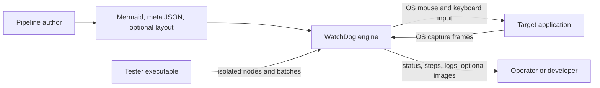

# Software Requirements Specification — WatchDog

- **Product:** watch-dog (`1.1.0`)
- **Format:** Requirements inventory informed by ISO/IEC/IEEE 29148:2011
- **Language:** English
- **Scope:** whole product (capture, pipeline engine, node testing, settings, target application)
- **Status:** reverse-engineered draft; requirements and priorities need product approval
- **Audit basis:** post-1.0 application-directory migration working tree; automated checks run through 2026-09-27
- **Companions:** SDD (observed design), pipeline format documentation and schemas

This draft was reconstructed from the implementation. A `shall` statement is a
candidate product requirement; it does not prove that the code meets it.

| How to read this draft | Location or meaning |
|------------------------|---------------------|
| Stakeholder needs | Inferred `STK-NNN` needs in §6; product approval remains open. |
| System requirements | `REQ-<AREA>-NNN` in §7, with draft priority `E` (Essential) or `D` (Desirable) and a proposed verification method from §8. |
| Assumptions | `ASM-NNN` in §5.5; these are outside the requirement set. |
| Ownership | A requirement prefix assigns an accountable capability in Appendix D. It does not prescribe a source directory. `IF` and quality prefixes span capabilities. |
| Implementation evidence | §9 records inspected alignment and verification limits. An unlisted requirement has not automatically passed a test. The SDD describes design paths and limits. |
| Traceability | §6 links needs to requirements; Appendix D maps capabilities. A full requirement → design → test matrix remains open. |

Terms used throughout: **pipeline** is Mermaid topology plus meta JSON;
**target** is the external application under automation; **node** is a step in
the pipeline graph.

---

## 1. Scope

This document specifies the system requirements for WatchDog, a
Windows-only desktop application for **codeless visual GUI automation**. A
pipeline author describes automation as a Mermaid flowchart plus a meta JSON
property document; the engine captures screen or window content, recognizes
visual states (template image, OCR text, color range, or custom recognizers),
and executes mouse/keyboard actions against a target application, with
retries, error edges, run status, and optional debug evidence.

The product ships three executables:

| Executable | Role |
|------------|------|
| `watch-dog.exe` | Production use: capture, pipeline authoring support, execution, settings |
| `watch-dog-tester.exe` | Developer/tester tooling: isolated Node Test, Node Emulator, batch runs |
| `watch-dog-target.exe` | Sample target application (`login` / `dashboard` / `settings` flows) used for development, testing, and demos |

Out of scope: non-Windows platforms, scripted (code-based) automation APIs,
remote orchestration of runs, and modification of the target application
under test.

## 2. Document status and verification

The ID, statement, priority, and proposed verification method are working
attributes. `E` and `D` express the draft author's judgment, not a release
gate accepted by the project. Code inspection supports the findings in §9;
the document does not claim ISO conformance or complete test coverage. `test`,
`review`, and `demo` are defined in §8. The stakeholder needs in §6 are also
inferred from the product and require confirmation by its owner.

## 3. Supporting references

| Reference | Role |
|-----------|------|
| `docs/pipeline-meta.md` | Detailed pipeline format description |
| `docs/pipeline-layout.md` | Graph presentation positions (never affects execution) |
| `docs/action-recorder.md` | Action Recorder controls, privacy, draft behavior, and platform limits |
| `schemas/watchdog-metadata.schema.json`, `schemas/watchdog-layout.schema.json` | Machine-readable contracts checked by the backend when parsing pipeline files |
| `src-tauri/resources/pipelines/sample/` | Shipped sample pipeline covered by executed Rust validation tests |

`docs/development.md` describes toolchain, build, and troubleshooting. These
references do not override observed runtime behavior when they differ.

## 4. Terms and definitions

| Term | Meaning |
|------|---------|
| Entry | The required `kind: "Entry"` node starting a run; carries no recognition or actions |
| Endpoint | A `kind: "Endpoint"` node that marks successful completion; carries no recognition or actions |
| Children quota | A parent node's `timeout`: the shared budget for trying its children round-robin |
| Error budget | A parent node's `error_timeout`: the budget for executing its error target |
| StepResult | Per-node execution record (`node_id`, `matched`, `confidence`, `box_region`, actions fired, timings, error) |
| PatrolState | Bounded per-run evidence of captures, action dispatch, and later visually observed states |
| State Matcher | Patrol VLM task that scores which nearby pipeline node matches one current frame |
| Action Effect Verifier | Patrol VLM task that compares one action attempt's before/after frames with its direct visual successors |
| LocatedState | Validated failure-time handoff containing the selected node, confidence, task source, capture identity, frame stability, and reason |
| Action attempt | One ordered action batch from a successful visit to a node, tracked from pre-dispatch frame through advisory effect classification |
| ROI | Region of interest: fixed rectangle or a prior node's recognized box |
| HWND | Native window handle identifying a capture/action target |
| Capture owner | Single holder (`none` / `manual` / `pipeline+run_id`) of the streaming session |
| Action recording | A bounded operator session that observes physical input and produces a reviewable action draft without editing or executing a pipeline |
| DirectML | GPU execution provider for the ONNX OCR runtime (NVIDIA/AMD/Intel) |
| IPC | Tauri inter-process command/event bridge between the React frontend and the Rust backend |
| Mermaid | `flowchart TD` topology source (`-->` next edges, `-->\|error\|` / `-.->` error edges) |
| TBD | To be determined; each occurrence is tracked in Appendix C |

---

## 5. System overview

### 5.1 Product perspective

WatchDog automates an external application through captured pixels and OS
input. It does not instrument that application.

| Stage | System behavior |
|-------|-----------------|
| Author | Supply topology, node properties, optional layout, image templates, and run parameters. |
| Start | Validate files and acquire exclusive capture ownership for the declared target. |
| Run | Read target frames, recognize node states, and dispatch input through the OS. |
| Observe | Publish live status, step results, progress, and optional debug evidence. |

### 5.2 Product functions (summary)

- **Capture:** enumerate screens/windows, stream screen or window client/frame
  areas via GDI/DXGI/Graphics engines, single-owner arbitration.
- **Authoring:** Mermaid + meta JSON authoring contract with validation
  (entry presence, edge cardinalities, ROI references, window-size rules).
- **Execution:** children-trying engine with parent quotas, error budgets,
  skips, repeats, delays, pause/stop, and per-step evidence.
- **Recognition:** DirectHit, TemplateMatch, OCR, ColorMatch, and Custom
  recognizers with ROI resolution and candidate selection.
- **Actions:** nine action types; window actions restore and verify foreground
  ownership before execution.
- **Node testing:** isolated recognition/action tests, single-node emulator,
  batch execution with logging.
- **Observability:** live status and polling recovery, step history, progress,
  debug images, phase timings, application logs, and Patrol Chat Room.
- **Patrol:** optional background VLM reports and run-scoped reference images;
  reports do not control pipeline routing or input.
- **Settings:** capture engine/area, OCR device, timing granularity, patrol
  options, and persisted versus session-only preferences.
- **Task notification:** optional native notification after pipeline completion
  and cleanup, plus optional Action Recorder start/stop confirmation.
- **Action Recorder:** Windows input observation bound to one selected capture
  target, with global controls, a persistent status bar, and reviewable output.
- **Updater:** production-only stable update checks against GitHub Releases,
  explicit idle-state installation, progress, and verified restart.

### 5.3 Users

| Class | Description | Technical level |
|-------|-------------|-----------------|
| Pipeline author | Writes Mermaid topology, meta JSON templates, parameters, image templates | Medium — understands graphs, regex, selective pixel reasoning |
| Operator | Selects targets, starts/pauses/stops runs, watches progress and logs | Low — follows runbooks, acts on error evidence |
| Developer/tester | Uses Node Test, Emulator, Debug Workbench; diagnoses recognition/action failures | High — reads timings, overlays, and logs |
| Target-app owner | Owns the automated application; provides stable UI and window identity | Medium — no WatchDog internals needed |

The target application itself is an actor: it is launched, resized,
foregrounded, and driven, but never instrumented.

### 5.4 Operating environment

| ID | Requirement | Pty | Verify |
|----|-------------|-----|--------|
| REQ-ENV-001 | The system shall run on Windows x64 only (WebView2, MSVC-built binaries, Win32/DXGI/DWM APIs). | E | review |
| REQ-ENV-002 | The Windows build shall use the toolchain documented in `docs/development.md`; runtime OCR shall load its packaged ONNX dependencies. | E | review |
| REQ-ENV-003 | The OCR subsystem shall fall back from DirectML GPU to CPU when GPU initialization fails. | E | test |
| REQ-ENV-004 | Only one capture owner shall hold the streaming session at a time (`none` \| `manual` \| `pipeline+run_id`); a pipeline run shall block manual streaming while it owns capture. | E | test |
| REQ-ENV-005 | The Windows production installer shall place the Sample Target companion beside the production executable so every bundled example pipeline can resolve its declared launch executable. Node Tester shall remain excluded from the production installer. | E | package test |

### 5.5 Assumptions and dependencies

| ID | Assumption / dependency to confirm |
|----|------------------------------------|
| ASM-001 | The target application renders consistently enough for the chosen template, OCR, and color thresholds. |
| ASM-002 | Referenced image templates and OCR models are present in the documented resources paths at run time. |
| ASM-003 | Default timing values (`timeout`/`error_timeout` 20000ms, `rate_limit` 1000ms, `pre_delay`/`post_delay` 200ms) are useful starting points; authors can tune nodes. |
| ASM-004 | The operator's Windows session permits screen capture and global input; exact permissions and policies still need investigation. |

---

## 6. Stakeholder requirements

Stakeholder needs; each traces to the system requirements that satisfy it.

| ID | Need | Pty | Traced system requirements |
|----|------|-----|----------------------------|
| STK-001 | As a pipeline author, I can automate a GUI flow without code, so that stable repetitive tasks run unattended. | E | REQ-AUTHOR-001, REQ-REC-001, REQ-ACT-001, REQ-CON-005 |
| STK-002 | As a pipeline author, I get precise validation diagnostics, so that authoring mistakes surface before a run. | E | REQ-AUTHOR-010, Appendix B |
| STK-003 | As an operator, I can start, pause, stop, and monitor a run with live progress, so that I stay in control. | E | REQ-PIPE-001, REQ-PIPE-010, REQ-PIPE-011, REQ-PIPE-015, REQ-OBS-002 |
| STK-004 | As an operator, I get failure evidence for every run, so that I can act without rerunning blindly. | E | REQ-PIPE-006, REQ-PIPE-016, REQ-OBS-003, REQ-OBS-004, REQ-REL-001 |
| STK-005 | As a developer, I can test a single node in isolation, so that I debug recognition and actions without full runs. | E | REQ-TEST-001, REQ-TEST-002, REQ-TEST-003 |
| STK-006 | As a developer, I can tune recognition using timings and visual overlays. | E | REQ-PIPE-017, REQ-REC-007 |
| STK-007 | As all users, automation never drives the wrong window, so that stray input cannot escape the target. | E | REQ-CON-001, REQ-CON-002 |
| STK-008 | As a target-app owner, my application is never instrumented or modified. | E | §5.1 perspective, REQ-IF-032 |
| STK-009 | As an operator, I can run checked pipelines as a batch with per-pipeline logs. | D | REQ-TEST-005 |
| STK-010 | As an operator, capture-affecting settings always open as off, so that runs never surprise-write to disk. | E | REQ-SET-002 |
| STK-011 | As an operator, I receive an optional native notification after a pipeline has fully completed, so that I do not need to watch the application continuously. | D | REQ-NOT-001, REQ-NOT-002 |
| STK-012 | As a pipeline author, I can capture real input as a safe draft, so that repetitive action coordinates and gestures do not need to be transcribed manually. | D | REQ-RCD-001…REQ-RCD-009 |
| STK-013 | As an operator, I can see and install a trusted WatchDog update without interrupting active automation. | D | REQ-UPD-001…REQ-UPD-006 |

---

## 7. System requirements

### 7.1 Functional requirements

#### 7.1.1 Capture

| ID | Requirement | Pty | Verify |
|----|-------------|-----|--------|
| REQ-CAP-001 | The system shall enumerate available screens for capture targeting. | E | test |
| REQ-CAP-002 | The system shall enumerate native windows with process, class, title, and bounds identity. | E | test |
| REQ-CAP-003 | The system shall stream a screen by index or a window by handle with frame or client capture area. | E | test |
| REQ-CAP-004 | The system shall arbitrate streaming through a single owner (`none` \| `manual` \| `pipeline+run_id`) and shall refuse pipeline capture ownership while held. | E | test |
| REQ-CAP-005 | Stream status shall report streaming state, target identity, capture engine, and session identity. | E | test |
| REQ-CAP-006 | The system shall resize a window client area through the window API. | E | test |
| REQ-CAP-007 | The engine shall bring the target window foreground during startup and restore and verify foreground immediately before every action (see REQ-CON-001). | E | test |
| REQ-CAP-008 | The engine shall skip frames captured before the previous actions completed when advancing nodes. | E | test |
| REQ-CAP-009 | The operator-configured frame cadence shall apply to manual streaming; pipeline capture runs at its fixed cadence. | E | test |
| REQ-CAP-010 | Lagged broadcast frames shall be skipped, never replayed as fresh evidence. | D | review |

#### 7.1.2 Authoring

| ID | Requirement | Pty | Verify |
|----|-------------|-----|--------|
| REQ-AUTHOR-001 | A pipeline shall consist of Mermaid topology plus meta JSON properties plus optional layout, merged with template → instance-override → label-fallback precedence. | E | test |
| REQ-AUTHOR-002 | Node configuration lookup shall fall back from instance to label (then ID) template. | E | test |
| REQ-AUTHOR-003 | Substitutable recognition and action fields shall resolve values in this order: parameter definition default, instance `param_values`, then explicit run values. The UI shall show instance values as defaults for declared parameters. | E | test |
| REQ-AUTHOR-004 | A pipeline shall declare exactly one `Entry`-kind node (see REQ-CON-005). | E | test |
| REQ-AUTHOR-005 | A node shall declare at most one error edge (see REQ-CON-006). | E | test |
| REQ-AUTHOR-006 | An ROI node reference shall name a different existing node; unknown, self, empty, or non-overlapping references shall fail recognition immediately. | E | test |
| REQ-AUTHOR-007 | `window_size` shall be declarable only on the top-level target, never on node overrides. | E | test |
| REQ-AUTHOR-008 | `repeat` shall be at least 1. | E | test |
| REQ-AUTHOR-009 | An `Entry` node shall not declare actions (`entry_node_has_actions`). | E | test |
| REQ-AUTHOR-010 | Validation shall return typed errors (`ValidationError` list) distinguishing missing metadata, entry, endpoint, edge, ROI, window-size, launch, and repeat violations. | E | test |
| REQ-AUTHOR-011 | A pipeline shall contain at least one `Endpoint` node. Endpoint nodes shall have no recognition settings, actions, or outgoing edges. Loading, saving, and starting shall reject violations. Multiple Endpoints are allowed. | E | test |

#### 7.1.3 Execution

| ID | Requirement | Pty | Verify |
|----|-------------|-----|--------|
| REQ-PIPE-001 | Pipeline startup shall parse, validate, compile routes, prepare the target window, and acquire capture ownership in that order before any run state is registered. | E | review |
| REQ-PIPE-002 | A filtered window target shall reuse an existing window; launch shall occur only when no match exists (or unconditionally for non-window targets). | E | test |
| REQ-PIPE-004 | After a node succeeds, the engine shall try its children (`n ≥ 0`) round-robin. `n == 0` completes only at an Endpoint and fails at any other node; `n == 1` re-selects the only child every round. | E | test |
| REQ-PIPE-005 | Trying children shall be bounded solely by the parent's `timeout` quota; a child's own `timeout` is the quota for its own children. | E | test |
| REQ-PIPE-006 | Quota exhaustion shall route the quota owner's error edge under the `error_timeout` budget with progress kept on the parent, or fail the run when no error edge exists. | E | test |
| REQ-PIPE-007 | Disabled nodes and nodes at `max_hit` shall be skipped with a `skipped: true` step record per the recording policy. | E | test |
| REQ-PIPE-008 | Actions shall repeat as a complete ordered list `repeat` times with `repeat_delay` pacing between rounds. | E | test |
| REQ-PIPE-009 | `pre_delay` shall run after recognition before actions; `post_delay` shall run after actions, including after action errors. | E | test |
| REQ-PIPE-010 | Pause shall suspend delays and actions; stop shall cancel them promptly. | E | test |
| REQ-PIPE-011 | Only one pipeline shall own capture at a time; a second start shall fail while ownership is held. | E | test |
| REQ-PIPE-012 | A finished run handle shall remain queryable for 60s so the frontend can poll the final status. | E | review |
| REQ-PIPE-013 | `Entry` nodes shall record a matched step and transition straight to children without frame acquisition, recognition, or actions. | E | test |
| REQ-PIPE-026 | An enabled `Endpoint` shall record a matched step and complete the run without frame acquisition, recognition, or actions. A non-Endpoint leaf shall fail with its node ID; enabled Patrol shall attempt its final advisory validation before failed status. | E | test |
| REQ-PIPE-014 | Recognition retries shall be paced by the node's `rate_limit` using a fresh frame per attempt. | E | test |
| REQ-PIPE-015 | Run status snapshots shall carry a monotonic revision so consumers ignore stale event/polling updates. | E | test |
| REQ-PIPE-016 | Debug images shall persist per recognition attempt, including misses and timeouts, when enabled. | E | test |
| REQ-PIPE-017 | Detailed timings shall break down frame acquisition, recognition, coordinates, delays, actions, and debug-image phases. | D | test |
| REQ-PIPE-018 | Failed startup shall attempt to restore window placement and release capture ownership; a placement restoration failure shall be included in the start diagnostic. | E | test |
| REQ-PIPE-019 | Run end shall attempt to restore window placement and release capture ownership; a restoration failure shall appear separately in final run status and events. | E | test |
| REQ-PIPE-020 | Enabled patrol shall save clean full capture-frame references after successfully visited nodes in a background worker, separate from annotated debug images. References shall be scoped to the current run and shall never be loaded from an earlier run. No prior recording run is required. A save failure shall be logged without changing the run outcome. | E | test |
| REQ-PIPE-021 | When patrol is enabled, the first validation shall start one Settings-controlled cycle after the run begins (20 seconds by default). Each later validation shall start after both the prior VLM response and a full cycle since that request started; a slow response shall trigger the next validation immediately when it arrives. At most one VLM request shall be in flight per run. Patrol shall prioritize a verifiable unresolved action attempt with newer same-session evidence; otherwise it shall run state matching. Both tasks shall run independently of recognition, actions, and routing. | E | test |
| REQ-PIPE-022 | The State Matcher shall receive only the current frame, anchor, nearby node descriptions, and available references. Every request shall contain at most 16 deterministically ordered candidates, prioritizing the anchor, direct normal successors, declared error successor, recent eligible nodes, then hop distance and graph order. When local scores are below threshold or ambiguous, it shall expand to the 2K-hop neighborhood, including shared-parent siblings. A positive non-inverted, non-DirectHit recognizer result may confirm the expected node when it has the highest VLM score above threshold. Action history shall not be included in this task. | E | test |
| REQ-PIPE-023 | Patrol shall emit task-specific reports with run and capture identity to the Execution Log. Periodic state and action reports shall remain advisory. Transient connection, HTTP 429, and HTTP 5xx failures shall retry once after 500 ms; request timeouts shall not retry immediately. Three consecutive transport failures shall open a per-run circuit, suppress later periodic requests, and emit one visible diagnostic. Before an impending failed run publishes terminal status, the engine shall stop periodic sampling, permit one final probe when the circuit is open, and share a 90-second active-time budget across final validation and recovery. Paused time shall not consume this budget and stop shall cancel it. The original pipeline failure shall be preserved on endpoint or deadline failure. Before terminal status, it shall finish outstanding reference saves and close report delivery so no Patrol report follows terminal status. | E | test |
| REQ-PIPE-024 | The engine shall keep bounded per-run patrol evidence for captured frames, recognition results, input dispatches, grouped action attempts, effect results, state-match decisions, and recovery decisions. Input text and arbitrary character keys shall be represented only by counts; allowlisted non-text control keys may use semantic names. Custom parameters shall be excluded. Images shall remain in bounded private/session caches rather than pipeline status. | E | test |
| REQ-PIPE-025 | A node may optionally wait for consecutive stable captured frames before actions and after dispatched actions. Zero disables either wait. The wait shall use the active capture target and session, a bounded timeout, configurable similarity and comparison area, and shall pause or stop with the run. A pre-action wait shall be followed by `pre_delay`, fresh-frame recognition, and action-target resolution before input. Wait timeout or failed refreshed recognition shall route through the node's error handling; `post_delay` shall still run after an action or post-wait error. | E | test |
| REQ-PIPE-027 | The Action Effect Verifier shall compare the exact pre-dispatch frame and a selected newer frame from the same target/session against only successfully dispatched effect-eligible actions in their actual repetition order. Failed and blocked actions remain in the evidence ledger but shall not be claimed to the VLM. `Wait`, `DoNothing`, and `StopTask` alone shall not create a request. A successful `post_wait_freezes` frame is preferred; otherwise Patrol shall observe for at most two active seconds and choose the latest frame after three samples at least 200 ms apart remain at least 0.98 similar. If stability is not reached, the latest newer frame shall be marked unstable; missing newer evidence shall skip verification with a diagnostic. The request requires a direct visual normal or declared error successor. Results below the action-effect threshold shall become `inconclusive`. Only a sufficiently confident `expected_successor` result may confirm the attempt. | E | test |
| REQ-PIPE-028 | Each VLM response shall be parsed and semantically validated against its task contract. Invalid JSON, fields, enums, scores, candidate IDs, or successor IDs shall cause one same-task format retry with the validation error and original inputs. A second invalid response shall produce `inconclusive`; raw responses and diagnostics shall remain observable, and invalid or inconclusive responses shall never affect routing. | E | test |
| REQ-PIPE-029 | At failure, Patrol shall establish a structured current location before recovery. A stable, above-threshold Action Effect Verifier `expected_successor` or declared `error_successor` result may establish it; every other action result shall fall back to State Matcher. Recovery candidates shall start with the located node, then enabled normal K-hop neighbors, recent eligible nodes, and remaining nodes by hop distance and graph order, capped at 16. The Recovery Advisor shall receive the current image, validated location fields, failure context, recent path, and candidate descriptions/actions; it shall not receive prior-task raw responses, before images, candidate references, or extra images. `hint_only` may publish an explicitly location-uncertain suggestion when location is unresolved. `redirection_only` shall reject unresolved location. A redirect shall also require sufficient confidence, unchanged capture target/session, an eligible node, remaining redirect quota, a new route, and no stop request. Accepted redirects begin a normal execution epoch; every rejection preserves the original failure. | E | test |

#### 7.1.4 Recognizers

| ID | Requirement | Pty | Verify |
|----|-------------|-----|--------|
| REQ-REC-001 | The system shall provide DirectHit, TemplateMatch, OCR, ColorMatch, and Custom recognizers through a registration-based plugin interface. | E | test |
| REQ-REC-002 | DirectHit shall always match and return the effective ROI as its box. | E | test |
| REQ-REC-003 | TemplateMatch shall locate template-similar regions filtered by threshold (default 0.7). | E | test |
| REQ-REC-004 | OCR shall recognize text blocks filterable by confidence, threshold (default 0.3), and optional expected regex. If no individual block matches, OCR shall also test the smallest compact sequence of adjacent blocks so a visually wrapped phrase can produce one bounded action candidate; distant text shall not be merged. | E | test |
| REQ-REC-005 | ColorMatch shall match pixels in the ROI against an inclusive RGB range and return the ROI as its box. | E | test |
| REQ-REC-006 | ROI shall resolve from a fixed rectangle or a prior node's box with offsets, clipped to the frame; empty or non-overlapping results shall fail recognition. | E | test |
| REQ-REC-007 | Candidate selection shall order (`native` default plus directional/confidence orders) and index into eligible results; DirectHit and ColorMatch ignore it. | E | test |
| REQ-REC-008 | The `inverse` flag shall invert the match result. | E | test |
| REQ-REC-009 | Custom recognizers shall dispatch by registered name with author-supplied JSON parameters. | E | test |

#### 7.1.5 Actions

| ID | Requirement | Pty | Verify |
|----|-------------|-----|--------|
| REQ-ACT-001 | The system shall provide DoNothing, Wait, Click, LongPress, Swipe, Scroll, ClickKey, InputText, StopTask, and Custom actions. | E | test |
| REQ-ACT-002 | Spatial targets shall resolve from recognized box (`true`), explicit coordinates, explicit rectangles, or prior-node boxes, plus optional offsets — all mapped into physical screen pixels. | E | test |
| REQ-ACT-003 | For a window target, each input action shall attempt to restore and verify target foreground immediately before input, including in isolated action tests (see REQ-CON-001). | E | test |
| REQ-ACT-004 | Targets outside the encoded capture frame shall fail rather than clamp (see REQ-CON-002). | E | test |
| REQ-ACT-005 | ClickKey shall emit the given key-code sequence; InputText shall emit substituted text. | E | test |
| REQ-ACT-006 | Swipe/Scroll shall honor duration and delta parameters; LongPress shall honor duration. | E | test |
| REQ-ACT-007 | DoNothing and StopTask shall execute as no-ops. | E | test |
| REQ-ACT-008 | Custom actions shall dispatch by registered name with author-supplied JSON parameters. | E | test |
| REQ-ACT-009 | `{{key}}` placeholders in action parameters shall substitute per-node user values. | E | test |
| REQ-ACT-010 | Wait shall express an explicit inter-action interval in milliseconds. Pipeline execution shall exclude paused time from that interval and allow stop requests to cancel it. | E | test |

#### 7.1.6 Node testing

| ID | Requirement | Pty | Verify |
|----|-------------|-----|--------|
| REQ-TEST-001 | Isolated recognition tests shall evaluate any recognizer against a supplied image or the last cached frame. | E | test |
| REQ-TEST-002 | Isolated action tests shall map and execute a single action in a supplied capture context. | E | test |
| REQ-TEST-003 | The system shall list, open, and execute named node metadata drafts end to end. | E | test |
| REQ-TEST-004 | The emulator shall build a runnable single node from draft fields with explicit validation errors per field. | D | test |
| REQ-TEST-005 | Batch execution shall run checked pipelines sequentially with per-pipeline logging and window-size retry semantics. | D | test |
| REQ-TEST-006 | Tester-provided user parameters shall substitute into recognition and action fields identically to runs. | E | test |
| REQ-TEST-007 | Recognition tests without a supplied image shall use the last cached frame, else fail with a diagnostic. | D | test |

#### 7.1.7 Observability

| ID | Requirement | Pty | Verify |
|----|-------------|-----|--------|
| REQ-OBS-001 | `get_pipeline_status` shall serve as the recovery path when events were missed. | E | test |
| REQ-OBS-002 | The graph shall show timeout progress on the parent node (normal or error quota) while highlighting the executing child. | E | test |
| REQ-OBS-003 | The UI shall retain the last 10 step results per pipeline; the backend shall retain the full history per run. | E | test |
| REQ-OBS-004 | Log entries shall record per-step outcomes and concise independent Patrol results. The start and recovery entries shall visibly tag Patrol recovery as `HINT ONLY` or `REDIRECT`; hint entries shall state that routing is unchanged, while redirect entries shall report acceptance or rejection. Action results shall use readable transition and state labels; capture identity, attempt ID, confidence, and exact VLM reasoning shall remain available in the Patrol Chat Room. Phase timings shall expand only in detailed mode. | D | review |
| REQ-OBS-005 | The UI shall prefer live events and poll at low frequency as backup. | E | review |
| REQ-OBS-006 | A read-only Patrol Chat Room shall show chronological Patrol operations on the right and VLM replies on the left, grouped by sample and filterable by run. Each message shall show a formatted summary with details closed by default; expanded details shall preserve task identity, exact prompt and response text, validation retries, candidate scores, action evidence, capture identity, location handoff or unresolved-location diagnostics, and on-demand task-relevant previews. Session history shall be bounded and clearing it shall also clear cached previews. | E | test |
| REQ-OBS-007 | Production and Tester startup shall display a splash window for at least 1.5 seconds while keeping the main window hidden. A determinate progress bar shall report real initialization stages for Tauri storage and legacy-data migration, retention cleanup, desktop services, pipeline schemas and resources, the persisted OCR device, and frontend Store hydration/readiness. The main window shall appear only after the minimum display time, backend initialization, and its hydrated first UI render are all satisfied; initialization warnings shall remain non-blocking, and a bounded fallback shall reveal the main window if splash coordination fails. Screen/window enumeration, Patrol run evidence, and VLM connections shall remain lazy because they can become stale or are run-specific. | E | test |

#### 7.1.8 Settings

| ID | Requirement | Pty | Verify |
|----|-------------|-----|--------|
| REQ-SET-001 | The system shall persist mode, FPS display, capture engine/area, timing granularity, OCR device, panel visibility, preview size, language, and non-secret tool preferences in the Tauri Store across window opens. An upgraded installation shall import existing `watchdog:*` browser-storage values once and delete each legacy value only after the Store save succeeds. | E | test |
| REQ-SET-002 | Save-to-disk and save-debug-images shall be session-only and always open as off, with an on-screen hint stating so. | E | test |
| REQ-SET-003 | The OCR device shall switch between CPU and DirectML at runtime with GPU-to-CPU fallback (see REQ-ENV-003). | E | test |
| REQ-SET-004 | Frame-cadence selection shall be disabled while streaming or under the event-driven engine. | D | test |
| REQ-SET-005 | Timing granularity shall select off, summary, or detailed execution logging. | E | test |
| REQ-SET-006 | Settings shall exclusively control engine patrol enablement, cycle seconds (default 20), K hops, state-match threshold, action-effect threshold, redirect threshold, minimum margin, recovery policy (`hint_only` default or `redirection_only`), maximum redirects per run (default 1), OpenAI-compatible chat-completions URL, vision model name, and session-only API key. Each threshold defaults to 0.85; persisted installations missing either new threshold shall copy the prior state-match threshold. Enablement and non-secret options shall persist; the key shall remain only in memory and shall not enter Store, browser storage, logs, or evidence. | E | test |
| REQ-SET-007 | Settings shall persist Task Notifier enablement, Action Recorder notification enablement, distinct Start/Stop and Pause/Resume shortcuts, and typed-text capture enablement. Typed-text capture and both notification options shall default off. | E | test |
| REQ-SET-008 | The GUI shall support English and Traditional Chinese through one shared localization service. Settings shall switch language without restarting, persist the selection across application windows, update the document language, and fall back to English for unavailable translations. | E | test |
| REQ-SET-009 | Settings shall persist automatic update checking, default it on, and retain a manual check regardless of the automatic setting. Update status, versions, plain-text notes, progress, errors, and actions shall be localized in English and Traditional Chinese. | D | test |

#### 7.1.10 Application updates

| ID | Requirement | Pty | Verify |
|----|-------------|-----|--------|
| REQ-UPD-001 | The production application shall check the stable GitHub Releases `latest.json` feed once after startup completion when automatic checks are enabled, and on explicit request. Network and manifest errors shall remain in Settings and AppLog without opening an error banner. | D | test |
| REQ-UPD-002 | An available update shall produce a persistent workspace banner and a Settings card containing current and offered versions, publication date, plain-text release notes, and download progress. Release HTML shall never be rendered. | D | test |
| REQ-UPD-003 | Installation shall require explicit operator confirmation and shall be disabled while a pipeline is running or paused or Action Recorder is recording or paused. Once installation starts, new pipeline and recorder work shall be rejected until install failure releases the guard or the application exits. | E | test |
| REQ-UPD-004 | Before installation exit, the application shall stop a manual capture stream. Failed download or installation shall preserve the available update for retry and release the runtime start guard. | E | test |
| REQ-UPD-005 | Production shall use the Tauri Updater and Process plugins with passive Windows installation. Tester, Splash, Preview, and Sample Target shall receive no updater or process capability. A portable production build may transition to the normal NSIS installation. | E | test |
| REQ-UPD-006 | Stable updates shall reject prereleases, downgrades, malformed manifests, and artifacts without a valid Tauri updater signature rooted in the embedded public key. | E | package test |

#### 7.1.9 Task notification and action recording

| ID | Requirement | Pty | Verify |
|----|-------------|-----|--------|
| REQ-NOT-001 | When enabled, Task Notifier shall issue exactly one native notification for a pipeline run after `completed` state and `cleanup_complete`; event and polling delivery shall not duplicate it. | E | test |
| REQ-NOT-002 | Notification denial or delivery failure shall not change the pipeline result and shall remain recoverable through Settings and the application log. | E | test |
| REQ-NOT-003 | Action Recorder start and stop notifications shall be independently optional; the persistent in-app recording bar shall remain the authoritative state indicator. | D | test |
| REQ-RCD-001 | Action Recorder shall implement `idle`, `recording`, `paused`, and `stopping` states and allow one recording session at a time. | E | test |
| REQ-RCD-002 | Start/Stop shall use one configurable global shortcut and Pause/Resume a distinct configurable global shortcut. Settings shall capture the next valid key combination, allow Escape to cancel, and temporarily unregister active recorder shortcuts while listening. Recorder control shortcuts shall not appear in the draft. | E | test |
| REQ-RCD-003 | A recording shall bind to the selected screen or window capture context. Start shall activate and verify a selected window; later window keyboard and committed pointer input shall be accepted only while that window is foreground. Target loss shall pause recording with a visible reason. | E | test |
| REQ-RCD-004 | On Windows, the recorder shall observe low-level keyboard and mouse input and translate left clicks, long presses, drags, wheel input, key commands, and printable typing into pipeline action types using capture-relative coordinates. Ordinary pointer movement shall remain unrecorded. | E | test |
| REQ-RCD-005 | Input marked by Windows as injected shall be discarded so WatchDog-generated automation does not enter a recording. | E | test |
| REQ-RCD-006 | Printable text shall be masked by default. When explicit typed-text capture is enabled, the UI shall warn that recorded text requires review and may contain sensitive data. | E | test |
| REQ-RCD-007 | The application shall show a persistent recording bar across views with state, target, elapsed time, action count, pause/resume, and stop controls. | E | test |
| REQ-RCD-008 | The Action Recorder view shall present formatted draft actions, warnings, active relative timing, derived inter-action waits, removal, copy, export, and clear controls. Pause duration shall not enter recorded timing. Copied pipeline actions and exported `pipeline_actions` shall contain explicit Wait actions for positive recorded gaps. Native export shall use the Tauri FS plugin with a Downloads-only `watchdog-action-recording-*.json` scope and shall show write failures. A draft shall not modify or execute a pipeline automatically. | E | test |
| REQ-RCD-009 | macOS and Linux shall retain the recorder command boundary but return a structured unsupported result until a platform input observer is implemented. | D | review |

### 7.2 Interface requirements

#### 7.2.1 File formats

| ID | Requirement | Pty | Verify |
|----|-------------|-----|--------|
| REQ-IF-001 | The system shall consume pipeline topology from Mermaid `flowchart TD` documents (`-->` next edges, `-->\|error\|` / `-.->` error edges). | E | test |
| REQ-IF-002 | The system shall consume node properties, templates, instances, targets, and launch configuration from `.meta.json` and reject files violating `watchdog-metadata.schema.json`. Patrol configuration in metadata shall be rejected with a Settings migration diagnostic. | E | test |
| REQ-IF-003 | The system shall consume graph presentation positions from `.layout.json`, reject files violating `watchdog-layout.schema.json`, and never let layout affect execution. | E | test |
| REQ-IF-004 | The system shall consume image templates as PNG files under the resources images path. | E | review |
| REQ-IF-005 | The system shall consume OCR models (`det.onnx`, `rec.onnx`, `keys.txt`) from the resources models path. | E | review |
| REQ-IF-006 | The system shall produce annotated debug images per recognition attempt under the visions debug path when enabled. | E | test |
| REQ-IF-007 | The system shall produce encoded image files for explicit capture / region-capture commands. | D | test |
| REQ-IF-008 | The system shall persist application logs to Tauri AppLog. | D | review |
| REQ-IF-009 | Writable application paths shall resolve through Tauri directories: Store in AppData, user resources in AppLocalData, generated visions in AppCache, logs in AppLog, and recorder exports in Downloads. Bundled resources shall resolve through the Resource directory. | E | test |

#### 7.2.2 IPC surface

| ID | Interface | Pty | Verify |
|----|-----------|-----|--------|
| REQ-IF-010 | The system shall expose screen commands: `get_screens`, `capture_screen`, `save_capture`, `save_region_capture`. | E | test |
| REQ-IF-011 | The system shall expose window commands: `get_windows`, `capture_window_by_hwnd`, `get_window_details`, `resize_window_client`. | E | test |
| REQ-IF-012 | The system shall expose stream commands: `start_stream`, `stop_stream`, `get_stream_status`. | E | test |
| REQ-IF-013 | The system shall expose desktop commands: `get_desktops`, `get_current_desktop`. | E | test |
| REQ-IF-014 | The system shall expose the target command `open_target_window`. | E | test |
| REQ-IF-015 | The system shall expose pipeline-editor commands: `load_pipeline`, source-preserving `save_pipeline(path, mermaid, meta)`, `save_pipeline_layout`, `validate_pipeline`, `list_pipelines`. | E | test |
| REQ-IF-023 | The system shall expose startup commands `get_startup_progress`, `initialize_app`, and `mark_main_window_ready`, and emit typed `startup-progress` events to the splash window. | E | test |
| REQ-IF-016 | The system shall expose pipeline-runner commands: `start_pipeline`, `stop_pipeline`, `pause_pipeline`, `get_pipeline_status`, `list_running_pipelines`, `test_action`, `test_recognition`, `set_recognition_device`. | E | test |
| REQ-IF-017 | The system shall expose node-test commands: `list_node_metas`, `open_window`, `test_node`. | E | test |
| REQ-IF-018 | The system shall emit `pipeline-status` events carrying revision-ordered run snapshots with an optional appended step, separate `patrol-report` and `patrol-recovery` events, and structured `patrol-chat-event` messages for operations and VLM exchanges. Recovery evidence and events shall optionally carry location node, confidence, source, stability, and uncertainty without breaking existing fields. Backend chat kinds shall use a serialized enum covering triggers, captures, searches, requests, responses, retries, reports, reference operations, action evidence, location handoff, unresolved location, recovery operations, and errors; the frontend union shall cover every enum value. The chat event shall not contain the API key or image base64 payloads. | E | test |
| REQ-IF-019 | The system shall emit `update_capture` events synchronizing the frontend capture view with backend stream ownership. | E | test |
| REQ-IF-020 | The system shall serve the live stream through the `watchdog:///frame` protocol. | E | test |
| REQ-IF-021 | `get_patrol_chat_image` shall retrieve a session-cached image by opaque ID for an opened message; `clear_patrol_chat_images` shall clear the cache. An evicted image shall produce an explicit unavailable result. | E | test |
| REQ-IF-022 | The system shall expose Action Recorder commands for status, start, pause, resume, stop, and clear, and shall emit `recorder-status`, `recorder-action`, and `recorder-error` events. | E | test |

#### 7.2.3 OS and runtime interfaces

| ID | Requirement | Pty | Verify |
|----|-------------|-----|--------|
| REQ-IF-030 | The system shall capture via GDI (compatible), DXGI duplication (fast), and Graphics Capture (event-driven) engines. | E | test |
| REQ-IF-031 | The system shall resolve and manage native windows through Win32 window-manager and DWM extended-frame-bounds APIs. | E | test |
| REQ-IF-032 | The system shall drive global mouse/keyboard input through the OS input stack. | E | test |
| REQ-IF-033 | The system shall run OCR through the ONNX runtime with DirectML acceleration and CPU fallback (see REQ-ENV-003). | E | test |
| REQ-IF-034 | The capture UI shall enumerate virtual desktops and filter its window list by desktop without switching the current desktop. | E | test |
| REQ-IF-035 | The desktop application shall use native notification and global-shortcut adapters behind Tauri permissions; notification and shortcut failures shall remain feature-local. | E | test |

### 7.3 Usability requirements

| ID | Requirement | Pty | Verify |
|----|-------------|-----|--------|
| REQ-USE-001 | Toggles that reset on window open shall carry an on-screen hint stating so. | E | test |
| REQ-USE-002 | Entry and Endpoint nodes shall render distinctly from normal nodes in the pipeline graph. | D | test |
| REQ-USE-003 | Node recognition, timing, and last-match details shall be viewable on demand. | D | test |
| REQ-USE-004 | Timeout progress shall signal severity through color bands. | D | test |

### 7.4 Reliability requirements

| ID | Requirement | Pty | Verify |
|----|-------------|-----|--------|
| REQ-REL-001 | Every node terminal outcome (match, timeout, recognition/action error, skip) shall record a `StepResult`. | E | test |
| REQ-REL-002 | No pipeline path shall silently drop a run: terminal states are `completed`, `failed` (with reason), or `stopped`. | E | test |

### 7.5 Performance efficiency requirements

| ID | Requirement | Pty | Verify |
|----|-------------|-----|--------|
| REQ-PERF-001 | Pipeline capture shall run at its fixed frame cadence independent of operator display settings. | E | review |
| REQ-PERF-002 | Recognition retries shall be paced by `rate_limit` (default 1000ms) with a fresh frame per attempt. | E | test |
| REQ-PERF-003 | The UI shall prefer live status events and poll at low frequency as backup. | E | review |
| REQ-PERF-004 | Progress and overlay geometry shall compute client-side from the last snapshot without backend round trips. | D | review |

### 7.6 Supportability requirements

| ID | Requirement | Pty | Verify |
|----|-------------|-----|--------|
| REQ-MNT-001 | New recognizers and actions shall register through the plugin registry without engine changes. | E | review |
| REQ-MNT-002 | The Tauri Log plugin shall write local-time Info-level records to stdout and dated AppLog files, rotate each file at 10 MiB, and retain at most 30 WatchDog-owned active or rotated log files at startup. Unrelated files in AppLog shall be left untouched. | E | test |
| REQ-MNT-003 | On main-app startup, clear generated contents of the visions directory when seven days have elapsed since the last successful cleanup, or on the first startup without a cleanup marker. Cleanup shall not touch user resources or follow directory links outside the visions root; failures shall be logged without blocking startup. | E | test |
| REQ-MNT-004 | Production code shall be organized into cohesive responsibility modules with documented dependency direction and narrow facades. Feature implementation details shall default to private or capability-local visibility. Production files should remain near 500 lines; larger executable files require a documented refactoring follow-up, while cohesive static data may be exempt. | D | review |

### 7.7 Security

| ID | Requirement | Pty | Verify |
|----|-------------|-----|--------|
| REQ-SEC-001 | Webview filesystem access shall default-deny. Main and Tester may write only timestamped Action Recorder JSON files below Downloads; Splash, Preview, and Sample Target shall receive no FS write permission. | E | test |
| REQ-SEC-002 | Legacy-data migration shall reject symbolic links, never overwrite destinations, remove a source only after a verified temporary copy is finalized, and retain conflicts or failures for recovery. | E | test |
| REQ-SEC-003 | Release signing credentials and PFX contents shall enter the build only through protected environment secrets, shall be removed after signing, and shall never be stored in the repository or packaged artifacts. | E | review |
| REQ-SEC-004 | Store shall hold non-secret preferences only. Store persistence shall not be described or used as secret storage. | E | test |
| REQ-SEC-005 | Updater private keys and passwords shall enter release jobs only through protected secrets and shall be removed with other temporary signing material. Losing the private key shall be treated as loss of the existing installation trust chain. | E | review |
| REQ-SEC-006 | Updater releases shall pass Tauri updater signature verification for update integrity. When all Authenticode settings are configured, Windows executables and NSIS shall additionally pass Authenticode verification for publisher identity; absence of Authenticode shall not block a Tauri-signed update release. | E | package test |

### 7.8 Design constraints

| ID | Requirement | Pty | Verify |
|----|-------------|-----|--------|
| REQ-CON-001 | For a window target, the engine shall attempt to activate the target before each action and send no input unless that window is then verified foreground; activation failure shall report `target_not_foreground`. | E | test |
| REQ-CON-002 | Action coordinates outside the encoded capture frame shall fail rather than clamp. | E | test |
| REQ-CON-003 | Graph layout (`.layout.json`) shall never affect execution semantics. | E | review |
| REQ-CON-004 | Pipeline saves shall be restricted to the canonical Tauri AppLocalData `resources/pipelines/` root; bundled pipelines and paths escaping the root shall remain read-only. | E | test |
| REQ-CON-005 | A pipeline shall declare exactly one `Entry`-kind node; zero shall fail with `missing_entry_node`, more than one with `invalid_entry_count`. | E | test |
| REQ-CON-006 | A node shall declare at most one error edge. | E | test |
| REQ-CON-007 | A client-area `window_size` declaration shall be verified within ±2px tolerance at startup; mismatch shall abort the start rather than run against wrong geometry. | E | test |

---

## 8. Verification provisions

| Method | Meaning |
|--------|---------|
| test | Executed check: unit, integration, system, or scripted verification of the statement. |
| review | Document, schema, or code inspection confirming the statement. |
| demo | Observed behavior in a live run. |

The `Traced system requirements` column provides an initial need-to-requirement
map. A complete requirement-to-design-to-test matrix has not been produced.
Priorities are proposals and cannot yet gate a release.

Appendix E gives concrete acceptance examples for timing, routing, and cleanup
rules that are easy to interpret differently. Each example names its requirement
IDs. The examples clarify expected outcomes; they are not claims that a test
has run. This is a selective Specification by Example practice: keep examples
beside requirements and link them to automated tests as they are added. The
project does not currently require a separate Gherkin or BDD test runner.

---

## 9. Implementation alignment and verification status

The table records inspected implementation paths and the remaining verification
limits. "Implemented" means source evidence was found, not that the requirement
passed a native acceptance test.

| Requirement(s) | Finding | Source evidence | Status |
|----------------|---------|-----------------|--------|
| REQ-AUTHOR-003 | Runtime merges defaults, instance values, and explicit run values; the loaded graph exposes effective defaults to the UI. | `authoring/parser/mod.rs`; `runtime/runner.rs` | Implemented; Rust tests require execution |
| REQ-ACT-003, REQ-CON-001, REQ-CAP-007 | Standalone actions require a context matching the active stream. Pipeline and isolated node actions restore and verify window foreground before each dispatch; a failed activation refuses input. | `runtime/runner.rs`; `testing/node_test.rs`; `runtime/engine/runner.rs` | Implemented; native activation and input tests required |
| REQ-ACT-001, REQ-ACT-010, REQ-RCD-008 | Metadata supports explicit Wait actions. Pipeline waits are cancellable and pause-aware; recorder copy/export derives waits from active-time offsets without counting long-press or swipe duration twice. | `authoring/models/action.rs`; `runtime/engine/runner.rs`; `recorder/service.rs`; `recorder/utils/recordingTiming.ts`; `schemas/watchdog-metadata.schema.json` | Rust serialization and frontend timing tests passed; native recorder timing walkthrough pending |
| REQ-IF-034 | Virtual desktops are used only to filter the capture window list. Pipeline desktop switching and `REQ-PIPE-003` are retired. | `capture/components/DesktopFilter.tsx`; `capture/stores/useWindowStore.test.ts`; `runtime/runner.rs` | Frontend filter test passed; native enumeration still requires verification |
| REQ-PIPE-018, REQ-PIPE-019 | Window restore returns a result. Startup appends cleanup failure to its diagnostic; run status/events carry a separate cleanup error and completion signal. | `capture/repositories/window/mod.rs`; `runtime/runner.rs`; `runtime/engine/mod.rs` | Implemented; native restoration test required |
| REQ-PIPE-009 | Pipeline `post_delay` is cancellable and runs after action attempts even when an action fails. | `runtime/engine/runner.rs` | Implemented; Rust test requires execution |
| REQ-PIPE-025 | Optional node freeze waits compare fresh frames on the active capture session; pre wait refreshes recognition before input and post wait precedes post delay. | `runtime/engine/freeze.rs`; `runtime/engine/runner.rs`; `schemas/watchdog-metadata.schema.json` | Implemented; native run verification pending |
| REQ-CON-004, REQ-IF-015 | `save_pipeline` accepts original Mermaid and metadata sources, validates them, and confines writes to the custom root. The graph-only API is rejected. | `authoring/editor.rs`; `src/api/pipeline.ts` | Implemented; path tests require execution |
| REQ-IF-002, REQ-IF-003 | Metadata and layout parsers validate against bundled Draft 2020-12 schemas before Serde conversion. | `authoring/parser/meta.rs`; `authoring/parser/layout.rs` | Implemented; bundled sample schema check passed |
| REQ-PIPE-020, REQ-SET-006 | Settings control patrol and VLM options. A successful node visit queues a clean reference image in the current run's directory; a new run begins with description-only candidates. The API key is session-only. | `runtime/patrol.rs`; `runtime/runner.rs`; `settings/views/SettingsView.tsx` | Unit and live VLM paths passed; bounded eviction remains an automated check |
| REQ-PIPE-021, REQ-PIPE-022 | Periodic Patrol chooses one task: unresolved action verification first, otherwise state matching. State matching contains no action history and expands an inconclusive local search to nearby candidates. | `runtime/patrol.rs`; `runtime/engine/runner.rs` | Unit and live slow-response/state-match paths passed |
| REQ-PIPE-023 | Periodic reports remain advisory. Failure stops periodic work, performs the action-to-state location handoff within the shared deadline, applies the recovery policy, then either resumes an accepted redirect or publishes terminal failure. | `runtime/engine/runner.rs`; `runtime/engine/runner/patrol_worker.rs`; `runtime/patrol.rs` | Unit pass; live hint failure and accepted-redirect completion passed |
| REQ-PIPE-024, REQ-PIPE-027 | Pipeline status exposes bounded dispatch and grouped attempt evidence. Exact before frames stay in a bounded private cache; only a valid action-effect result for a declared direct visual successor confirms an attempt. | `runtime/engine/patrol_state.rs`; `runtime/engine/runner.rs`; `runtime/patrol.rs` | Unit and live before/after VLM classification passed |
| REQ-PIPE-028 | State-match, action-effect, and recovery responses use strict local parsing and semantic validation, one same-task format retry, then an inconclusive result. | `runtime/patrol.rs` | Parser tests passed; live malformed-response walkthrough pending |
| REQ-PIPE-029 | The engine converts qualified Task 2 or Task 1 output into `LocatedState`, anchors deterministic bounded recovery candidates there, and sends Task 3 only the current image and structured metadata. Hint policy may report uncertain location; redirection validates resolved location, confidence, capture identity, node eligibility, run limit, and route uniqueness before starting a new execution epoch. | `runtime/patrol/protocol.rs`; `runtime/patrol/search.rs`; `runtime/patrol/vlm.rs`; `runtime/engine/runner.rs`; `runtime/engine/runner/patrol_worker.rs`; `runtime/engine/routing.rs` | Structured location and candidate unit tests pass; native Task 1 fallback and redirect walkthroughs pending |
| REQ-OBS-006, REQ-IF-018, REQ-IF-021 | The Patrol Chat Room shows the session trace with formatted, collapsed messages and on-demand images. Its listener collects events while the view is closed; the backend emits exact request and response content without API keys. | `runtime/chat.rs`; `runtime/views/PatrolChatRoom.tsx` | Live VLM/event display passed; image eviction/unavailable preview remains automated only |
| REQ-OBS-007, REQ-IF-023 | Production and Tester create a visible splash beside a hidden main webview. `startup.rs` reports real preload stages and reveals the main window only after backend and first-render readiness, with a bounded fallback. | `startup.rs`; `main-splash.tsx`; `SplashScreen.tsx`; production and Tester Tauri configs | Startup gate, capability, preference, and native window-transition tests pass |
| REQ-SET-001, REQ-IF-009, REQ-SEC-004 | Production persistence uses one asynchronous Tauri Store adapter, imports legacy `watchdog:*` browser values after a successful Store save, and keeps session-only values out of persisted state. | `shell/services/persistence.ts`; Zustand stores; `i18n/index.ts` | Adapter migration and browser fallback tests pass; installed upgrade walkthrough pending |
| REQ-NOT-001…003, REQ-SET-007 | Task Notifier requests permission on explicit enablement, deduplicates by task ID, and sends pipeline completion only after terminal cleanup. Recorder start/stop uses the same service. | `notifications/services/taskNotifier.ts`; `pipeline/runtime/stores/usePipelineStore.ts`; `settings/views/SettingsView.tsx` | Frontend service and settings tests passed; installed-build notification walkthrough pending |
| REQ-RCD-001…009, REQ-IF-022, REQ-IF-035, REQ-SEC-001 | The Rust recorder owns session state and Windows low-level hooks; injected input is excluded, events map to capture-relative action drafts, and the frontend provides hotkeys, status bar, review, copy, scoped Downloads export, removal, and clear. Non-Windows start returns unsupported. | `modules/recorder/`; `recorder/services/exportRecording.ts`; capability files; `recorder/views/ActionRecorderView.tsx` | Rust gesture/coordinate and frontend export/settings tests pass; native hook walkthrough pending |
| REQ-IF-009, REQ-MNT-002, REQ-MNT-003, REQ-SEC-002 | Startup resolves Tauri application directories, safely migrates the legacy home tree, bounds owned Log-plugin files, and periodically clears generated AppCache visions. | `core/paths.rs`; `core/logger.rs`; `core/maintenance.rs`; `startup.rs` | Migration, conflict, symlink, retention, and cleanup unit tests pass; clean-profile installed walkthrough pending |
| REQ-SEC-003 | When the optional Authenticode secret set is complete, the dedicated Windows workflow imports its PFX temporarily, signs and verifies every distributed executable and NSIS, and removes temporary material in `finally`. Partial configuration fails clearly; updater-only releases require no PFX. | `build-signed-windows.ps1`; `release-windows-signed.yml`; `verify-release-config.mjs` | Static release verification passes; trusted-certificate workflow execution pending |
| REQ-UPD-001…006, REQ-SET-009, REQ-SEC-005…006 | Production checks once after splash completion, presents a localized banner and Settings card, gates installation on idle runtime state, and publishes a Minisign-verified `latest.json` only from a matching `v*` tag. | `modules/updater/`; production capability/config; `build-signed-windows.ps1`; `prepare-github-release.mjs`; release workflow | Frontend and capability tests pass; signed installed/portable update walkthrough pending |
| REQ-MNT-004 | Backend dependencies follow `core → capture → authoring → plugins → runtime → testing`; frontend integration uses shell and observability contracts. Capture ownership, Patrol services, authoring validation, plugin coordinates/OCR, runtime helpers, testing metadata, pipeline API clients, and feature styles have dedicated modules. | `src/architecture.test.ts`; `modules/capture/services/stream/`; `modules/pipeline/runtime/patrol/`; `modules/pipeline/runtime/engine/runner/`; `src/api/pipeline/` | Architecture test and full compile pass; large coordinator follow-ups are recorded in SDD §8 |

The frontend production build and all 159 frontend tests pass. The Windows
build now delay-loads Common Controls so the Rust unit-test harness does not
resolve an unused Tauri dialog entry point before tests start; the application
binary still links successfully with Tauri's manifest. The Rust suite reports
196 passing library tests and one intentionally ignored OCR runtime/model test,
plus the passing preview capability integration test.
These automated checks cover pure routing, configuration, state, and filesystem
behavior. Live capture, foreground input, OCR, VLM action classification, hint
recovery, and accepted redirection have executable-level evidence. Window
restoration refusal, malformed-response retry, and rejected redirects still
require executable-level checks.

---

## Appendices

### Appendix A — Requirement index

| Area | IDs | Section |
|------|-----|---------|
| Stakeholder needs | `STK-001`…`013` | §6 |
| Capture / authoring / execution | `REQ-CAP-001`…`010`; `REQ-AUTHOR-001`…`011`; `REQ-PIPE-001`…`002`, `004`…`026` | §7.1; `REQ-PIPE-003` retired |
| Recognition / actions / testing | `REQ-REC-001`…`009`; `REQ-ACT-001`…`010`; `REQ-TEST-001`…`007` | §7.1 |
| Observability / settings / operator tools | `REQ-OBS-001`…`007`; `REQ-SET-001`…`009`; `REQ-NOT-001`…`003`; `REQ-RCD-001`…`009`; `REQ-UPD-001`…`006` | §7.1 |
| Interfaces | `REQ-IF-001`…`009` (files); `010`…`023` (IPC); `030`…`035` (OS/runtime) | §7.2 |
| Security | `REQ-SEC-001`…`006` | §7.7 |
| Usability / reliability / performance | `REQ-USE-001`…`004`; `REQ-REL-001`…`002`; `REQ-PERF-001`…`004` | §7.3–7.5 |
| Supportability / constraints | `REQ-MNT-001`…`004`; `REQ-CON-001`…`007` | §7.6, §7.8 |
| Environment / assumptions | `REQ-ENV-001`…`005`; `ASM-001`…`004` | §5.4–5.5; assumptions are not requirements |

### Appendix B — Error-code glossary

| Code | Meaning |
|------|---------|
| `missing_entry_node` | No `Entry`-kind node declared |
| `invalid_entry_count` | More than one `Entry`-kind node declared (validation and plan-compile sides share the name) |
| `entry_node_has_actions` | `Entry` node declares actions (never execute) |
| `missing_endpoint_node` | No `Endpoint` node declared |
| `endpoint_node_has_recognition` / `endpoint_node_has_actions` | Endpoint declares operations that never execute |
| `endpoint_node_has_outgoing_edges` | Endpoint declares an outgoing edge |
| `target_not_foreground` | Target window could not be made foreground at action time; input refused |
| `ambiguous_transition` | More than one error edge from one node |
| `invalid_repeat` | `repeat` below 1 |
| `invalid_roi_reference` | ROI references unknown, self, or unusable node |
| `invalid_window_size` / `node_window_size_not_supported` | Window-size declaration or placement violations |
| `invalid_launch` / `launch_requires_window_filter` | Launch configuration violations |
| `missing_node_metadata` | A Mermaid node has no matching instance or template metadata |
| `cycle_detected` / `unreachable_node` / `invalid_edge` | Graph structure violations |

### Appendix C — Open issues / TBD list

- TBD-001 (§5.5 ASM-004): enumerate exact Windows capabilities/policies required for capture and global input.

### Appendix D — Capability and requirement map (normative)

This map assigns accountability for requirements, not source-file ownership.
The SDD defines components, file locations, dependencies, and interfaces.
Frontend and backend code may both contribute to one capability.

| Code | Accountable capability | Responsibility and boundary |
|------|------------------------|-----------------------------|
| CAP | Capture | Discover screens, windows, and desktops; acquire frames; manage stream ownership and capture targets. Exposes frames and target identity to execution and testing. |
| AUTHOR | Pipeline authoring | Parse, merge, validate, load, and save topology, metadata, and layout. Exposes a validated graph to execution and testing. Layout remains presentation-only. |
| PIPE | Pipeline execution | Compile routes; coordinate startup, run lifecycle, quotas, retries, delays, and recovery; request capture, recognition, and actions. Produces run state and step evidence. |
| REC | Recognition | Evaluate registered recognizers, resolve ROI, and select candidates using a supplied frame and node configuration. Testing uses the same behavior. |
| ACT | Actions | Resolve action targets and execute registered mouse/keyboard actions. Pipeline and isolated window-target paths apply foreground and coordinate guards. |
| TEST | Node and batch testing | Build isolated test contexts and run node or batch tests through the production capture, recognition, action, and execution contracts. |
| OBS | Observability | Publish and display run status, step history, timing, logs, progress, and debug evidence. Execution produces evidence; UI presents it. |
| SET | Settings and preferences | Manage operator choices, persistence, session-only flags, and settings controls. Supply effective settings to the capabilities that consume them. |
| NOT | Task notification | Request permission and deliver deduplicated native task completion messages without affecting task outcomes. |
| RCD | Action recording | Observe physical operator input, bind it to a capture target, and produce a non-executing review draft. |

`IF` identifies file, IPC, OS, and runtime contracts; each interface is
implemented by the capability that provides it. `USE`, `PERF`, `REL`, and
`MNT` describe cross-cutting quality characteristics. `ENV` and `CON`
describe environment and constraints; `ASM` marks assumptions outside the
requirement set. These prefixes are not additional modules. The application
shell, shared utilities, and sample target support the capabilities above; they do not
define separate requirement ownership in this SRS.

### Appendix E — Acceptance examples (illustrative)

These examples make boundary cases in §7 concrete. They are candidates for
automated tests; this appendix does not report a passing test result. Each
example names the requirements it clarifies.

#### E.1 Endpoint completion (`REQ-AUTHOR-011`, `REQ-PIPE-026`)

- **Given** a validated graph with Entry, a normal leaf `LastClick`, and an Endpoint elsewhere.
- **When** execution reaches `LastClick` without an outgoing route.
- **Then** the impending failure contains `LastClick` in the reason. If Patrol
  is enabled, final validation and the configured recovery task run before the
  engine resumes an accepted redirect or publishes failed status.

An enabled Endpoint reached by execution instead records a matched step and
completes without capture, recognition, or actions at that node.

#### E.2 Patrol cadence (`REQ-PIPE-021`, `REQ-PIPE-023`)

- **Given** Patrol is enabled with a 20-second cycle and a VLM response takes 28 seconds.
- **When** the first request starts 20 seconds after run start.
- **Then** a second periodic request may start as soon as the first response
  arrives. Requests do not overlap. Reports remain advisory even if execution
  has advanced.

#### E.3 Run-scoped references (`REQ-PIPE-020`)

- **Given** run A saved a reference for node `Login`, and run B starts on the same pipeline.
- **When** Patrol evaluates `Login` before run B has visited it.
- **Then** run B uses the description and no image from run A. A successful
  visit in run B can save its own reference.

#### E.4 Window input safety (`REQ-CON-001`, `REQ-ACT-003`)

- **Given** a window target was foreground during recognition but lost foreground before a click.
- **When** the action is ready to dispatch.
- **Then** the engine tries to activate and verify that window again. If
  verification fails, it sends no input and reports `target_not_foreground`.

#### E.5 Cleanup visibility (`REQ-PIPE-019`)

- **Given** a run has an execution outcome and Windows refuses placement restoration.
- **When** run-end cleanup finishes.
- **Then** status retains the execution outcome and exposes a separate
  `cleanup_error` and completion signal.

#### E.6 Startup retention (`REQ-MNT-002`, `REQ-MNT-003`)

- **Given** the main app opens with more than 30 WatchDog-owned active or rotated logs and vision cleanup is due.
- **When** startup maintenance runs.
- **Then** the 30 newest owned logs, including the current log, remain;
  generated visions are cleared within the user-data root. Cleanup failures
  are logged without blocking startup.

#### E.7 Terminal Patrol cutoff (`REQ-PIPE-023`)

- **Given** an enabled periodic Patrol request is active when a pipeline reaches an Endpoint.
- **When** the engine prepares and publishes completed status.
- **Then** it cancels unfinished periodic work, closes the run's report gate,
  and emits no later Patrol report. The UI also discards a report delivered
  after it has already observed terminal status for that run.

#### E.8 Patrol task selection (`REQ-PIPE-021`, `REQ-PIPE-022`, `REQ-PIPE-027`)

- **Given** a sent action attempt, its exact before frame, declared direct
  visual successors, and a newer frame from the same target/session.
- **When** the next Patrol cycle starts.
- **Then** it sends one Action Effect Verifier request containing the ordered
  sanitized action batch and before/after evidence, and it does not include a
  K-hop state-localization task in that request.
- **And given** no eligible unresolved action attempt, **when** a cycle starts,
  **then** it sends one Current State Matcher request without action history.

#### E.9 Invalid VLM response (`REQ-PIPE-028`)

- **Given** either VLM task returns malformed or semantically invalid JSON.
- **When** Patrol validates the response.
- **Then** it sends the same task once more with the validation error and
  original inputs.
- **And when** the second response is also invalid, **then** Patrol records an
  inconclusive advisory result, retains both raw responses in the Chat Room,
  and leaves pipeline routing unchanged.

#### E.10 Patrol recovery (`REQ-PIPE-029`)

- **Given** the final Action Effect Verifier returns a stable, confident
  declared successor, **when** failure finalization begins, **then** that
  result becomes `LocatedState` and State Matcher is skipped.
- **Given** the action result is unchanged, in progress, unstable,
  low-confidence, malformed, inconclusive, or names the wrong successor,
  **when** failure finalization continues, **then** State Matcher runs on the
  current frame and supplies the structured location when its scores are
  confident and unambiguous.
- **Given** normal and graph-declared error routing have reached an impending
  terminal failure but location remains unresolved, **when** the configured
  policy is `hint_only`, **then** Patrol may recommend one candidate around
  the failure node and recent path, marks the hint location-uncertain, logs it,
  and preserves the original failure.
- **Given** location remains unresolved and policy is `redirection_only`,
  **then** Patrol rejects recovery without asking Task 3 to redirect.
- **Given** the policy is `redirection_only`, **when** Patrol selects an
  allowlisted normal node above threshold on the unchanged capture session and
  the redirect limits allow it, **then** the engine clears failure and child
  state, resets hit quotas, and executes that node through the normal engine.
- **Given** an unknown node, low confidence, changed capture session, repeated
  route, exhausted limit, or invalid response, **when** the engine validates
  the proposal, **then** it rejects the redirect and preserves the failure.

#### E.11 Completion notification (`REQ-NOT-001`, `REQ-NOT-002`)

- **Given** Task Notifier is enabled and the same completed run arrives through
  both a status event and polling, **when** cleanup becomes complete, **then**
  one native notification identifies the pipeline, duration, and step count.
- **Given** permission is denied or native delivery fails, **then** the run
  remains completed and the application records a notification diagnostic.

#### E.12 Action recording safety (`REQ-RCD-002`…`REQ-RCD-006`)

- **Given** a recording is bound to a foreground window, **when** the operator
  clicks, drags, scrolls, and types, **then** the draft uses capture-relative
  existing action types and masks printable text by default.
- **Given** input carries a Windows injected flag or belongs to either recorder
  shortcut, **then** the draft omits it.
- **Given** the target is no longer foreground or available, **then** recording
  pauses with a visible reason instead of accepting further target input.

### Appendix F — Example-to-test traceability

Results below are current through 2026-09-23. A **unit pass** verifies the named policy or
data transition. A **live check pending** identifies behavior that requires a
real window, capture session, model, or OS refusal.

| Example | Automated evidence | Result | Remaining live check |
|---------|--------------------|--------|----------------------|
| E.1 Endpoint completion | `runtime::engine::routing::tests::only_endpoint_without_children_completes`; `authoring::editor::validation_tests::load_rejects_pipeline_without_endpoint` | Unit and live pass | Live run confirmed Endpoint completion and final Patrol before failed status. |
| E.2 Patrol cadence | `runtime::engine::runner::parameter_tests::patrol_cycles_wait_for_both_period_and_response`; `patrol_sampling_is_single_flight`; `terminal_run_cancels_unfinished_patrol_work` | Unit and live pass | Slow VLM response behavior confirmed. |
| E.3 Run-scoped references | `runtime::patrol::tests::references_are_isolated_by_run`; `description_only_first_visit_can_select_a_node` | Unit and live pass | Two pipeline runs confirmed separate reference directories. |
| E.4 Window input safety | `capture::repositories::window::size_tests::global_input_requires_the_exact_foreground_window`; `runtime::runner::action_test_tests::action_context_requires_the_active_capture_target_and_frame` | Policy and live pass | Focus-loss behavior confirmed. |
| E.5 Cleanup visibility | `runtime::engine::cleanup_status_tests::cleanup_failure_is_separate_from_execution_result_in_status_and_event` | Unit pass | Force Windows placement restoration to fail and inspect the UI event. |
| E.6 Startup retention | `core::maintenance::tests::keeps_current_and_newest_dated_logs`; `clears_visions_only_when_interval_is_due`; `vision_cleanup_never_follows_a_nested_link` | Unit pass; live check deferred | Restart and folder inspection were deferred. Link traversal runs when Windows permits symlink creation. |
| E.7 Terminal Patrol cutoff | `runtime::engine::runner::parameter_tests::terminal_run_cancels_unfinished_patrol_work`; frontend `usePipelineStore` late-report test | Automated and live pass after fixing the completed-run ordering defect | Successful pipeline recheck confirmed that no Patrol report appears after Completed. |
| E.8 Patrol task selection | `runtime::engine::runner::parameter_tests::patrol_prioritizes_a_sent_unresolved_action_with_a_newer_same_session_frame`; typed task-specific request builders | Unit and live pass | Wrong-password and controlled missed-click runs produced before/after action classifications. |
| E.9 Invalid VLM response | `runtime::patrol::tests::parses_model_scores_with_or_without_markdown_fence`; `action_effect_response_is_strict_and_successor_bounded` | Parser and semantic validation pass | Live two-response format-retry walkthrough pending. |
| E.10 Patrol recovery | `runtime::patrol::tests::recovery_candidates_start_with_location_then_prioritize_route`; `state_match_result_preserves_selected_confidence`; `runtime::engine::runner::patrol_worker::stability_tests::only_stable_declared_successor_effects_establish_location`; `recovery_response_is_policy_and_candidate_bounded`; routing and frontend recovery-log tests | Unit, live hint, and prior accepted-redirect pass | Native Task 2 handoff, Task 1 fallback, uncertain hint, and accepted/rejected redirect walkthroughs remain pending for this handoff release. |
| E.11 Completion notification | `taskNotifier.test.ts`; pipeline terminal cleanup gate in `usePipelineStore.ts` | Unit pass | Installed Windows notification identity and delivery walkthrough pending. |
| E.12 Action recording safety | `recorder::service::tests`; `useRecorderStore.test.ts`; `ActionRecorderView.test.tsx`; Settings tests | Unit and UI pass | Native global hook, injected-event, foreground-loss, and coordinate walkthrough pending. |
| E.13 Splash startup | `startup::tests::reveal_requires_both_backend_and_interface_readiness`; `splash_configuration`; `SplashScreen.test.tsx`; production frontend build | Unit, configuration, UI, and native transition pass | Forced 30-second fallback smoke test remains pending. |

Verification commands: `npm test` (140 passed), `npm run build`, `cargo check`,
`cargo test --no-run`, and `cargo test` (180 passed, 1 ignored).
