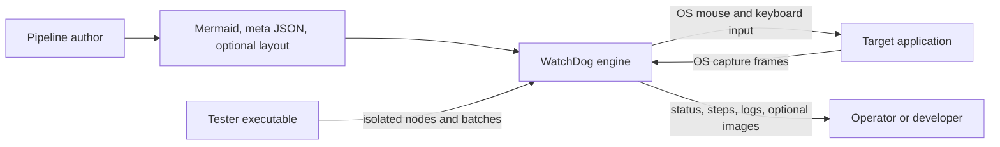

# Software Requirements Specification — WatchDog

- **Product:** watch-dog (`0.1.0`)
- **Format:** Requirements inventory informed by ISO/IEC/IEEE 29148:2011
- **Language:** English
- **Scope:** whole product (capture, pipeline engine, node testing, settings, target application)
- **Status:** reverse-engineered draft; requirements and priorities need product approval
- **Audit basis:** working tree inspected and automated checks run 2026-09-21; not a release baseline
- **Companions:** SDD (observed design), pipeline format documentation and schemas

This draft was reconstructed from the implementation. A `shall` statement is a
candidate product requirement; it does not prove that the code meets it.

| How to read this draft | Location or meaning |
|------------------------|---------------------|
| Stakeholder needs | Inferred `STK-NNN` needs in §6; product approval remains open. |
| System requirements | `REQ-<AREA>-NNN` in §7, with draft priority `E` (Essential) or `D` (Desirable) and a proposed verification method from §8. |
| Assumptions | `ASM-NNN` in §5.5; these are outside the requirement set. |
| Ownership | A requirement prefix assigns an accountable capability in Appendix D. It does not prescribe a source directory. `IF` and quality prefixes span capabilities. |
| Implementation evidence | §9 records inspected alignment and verification limits. An unlisted requirement has not automatically passed a test. The SDD describes design paths and limits. |
| Traceability | §6 links needs to requirements; Appendix D maps capabilities. A full requirement → design → test matrix remains open. |

Terms used throughout: **pipeline** is Mermaid topology plus meta JSON;
**target** is the external application under automation; **node** is a step in
the pipeline graph.

---

## 1. Scope

This document specifies the system requirements for WatchDog, a
Windows-only desktop application for **codeless visual GUI automation**. A
pipeline author describes automation as a Mermaid flowchart plus a meta JSON
property document; the engine captures screen or window content, recognizes
visual states (template image, OCR text, color range, or custom recognizers),
and executes mouse/keyboard actions against a target application, with
retries, error edges, run status, and optional debug evidence.

The product ships three executables:

| Executable | Role |
|------------|------|
| `watch-dog.exe` | Production use: capture, pipeline authoring support, execution, settings |
| `watch-dog-tester.exe` | Developer/tester tooling: isolated Node Test, Node Emulator, batch runs |
| `watch-dog-target.exe` | Sample target application (`login` / `dashboard` / `settings` flows) used for development, testing, and demos |

Out of scope: non-Windows platforms, scripted (code-based) automation APIs,
remote orchestration of runs, and modification of the target application
under test.

## 2. Document status and verification

The ID, statement, priority, and proposed verification method are working
attributes. `E` and `D` express the draft author's judgment, not a release
gate accepted by the project. Code inspection supports the findings in §9;
the document does not claim ISO conformance or complete test coverage. `test`,
`review`, and `demo` are defined in §8. The stakeholder needs in §6 are also
inferred from the product and require confirmation by its owner.

## 3. Supporting references

| Reference | Role |
|-----------|------|
| `docs/pipeline-meta.md` | Detailed pipeline format description |
| `docs/pipeline-layout.md` | Graph presentation positions (never affects execution) |
| `schemas/watchdog-metadata.schema.json`, `schemas/watchdog-layout.schema.json` | Machine-readable contracts checked by the backend when parsing pipeline files |
| `src-tauri/resources/pipelines/sample/` | Shipped sample pipeline (covered by a Rust test that compiles but could not be executed on the review machine) |

`docs/development.md` describes toolchain, build, and troubleshooting. These
references do not override observed runtime behavior when they differ.

## 4. Terms and definitions

| Term | Meaning |
|------|---------|
| Entry | The required `kind: "Entry"` node starting a run; carries no recognition or actions |
| Endpoint | A `kind: "Endpoint"` node that marks successful completion; carries no recognition or actions |
| Children quota | A parent node's `timeout`: the shared budget for trying its children round-robin |
| Error budget | A parent node's `error_timeout`: the budget for executing its error target |
| StepResult | Per-node execution record (`node_id`, `matched`, `confidence`, `box_region`, actions fired, timings, error) |
| PatrolState | Bounded per-run evidence of captures, action dispatch, and later visually observed states |
| ROI | Region of interest: fixed rectangle or a prior node's recognized box |
| HWND | Native window handle identifying a capture/action target |
| Capture owner | Single holder (`none` / `manual` / `pipeline+run_id`) of the streaming session |
| DirectML | GPU execution provider for the ONNX OCR runtime (NVIDIA/AMD/Intel) |
| IPC | Tauri inter-process command/event bridge between the React frontend and the Rust backend |
| Mermaid | `flowchart TD` topology source (`-->` next edges, `-->\|error\|` / `-.->` error edges) |
| TBD | To be determined; each occurrence is tracked in Appendix C |

---

## 5. System overview

### 5.1 Product perspective

WatchDog automates an external application through captured pixels and OS
input. It does not instrument that application.

| Stage | System behavior |
|-------|-----------------|
| Author | Supply topology, node properties, optional layout, image templates, and run parameters. |
| Start | Validate files and acquire exclusive capture ownership for the declared target. |
| Run | Read target frames, recognize node states, and dispatch input through the OS. |
| Observe | Publish live status, step results, progress, and optional debug evidence. |

### 5.2 Product functions (summary)

- **Capture:** enumerate screens/windows, stream screen or window client/frame
  areas via GDI/DXGI/Graphics engines, single-owner arbitration.
- **Authoring:** Mermaid + meta JSON authoring contract with validation
  (entry presence, edge cardinalities, ROI references, window-size rules).
- **Execution:** children-trying engine with parent quotas, error budgets,
  skips, repeats, delays, pause/stop, and per-step evidence.
- **Recognition:** DirectHit, TemplateMatch, OCR, ColorMatch, and Custom
  recognizers with ROI resolution and candidate selection.
- **Actions:** nine action types; window actions restore and verify foreground
  ownership before execution.
- **Node testing:** isolated recognition/action tests, single-node emulator,
  batch execution with logging.
- **Observability:** live status and polling recovery, step history, progress,
  debug images, phase timings, application logs, and Patrol Chat Room.
- **Patrol:** optional background VLM reports and run-scoped reference images;
  reports do not control pipeline routing or input.
- **Settings:** capture engine/area, OCR device, timing granularity, patrol
  options, and persisted versus session-only preferences.

### 5.3 Users

| Class | Description | Technical level |
|-------|-------------|-----------------|
| Pipeline author | Writes Mermaid topology, meta JSON templates, parameters, image templates | Medium — understands graphs, regex, selective pixel reasoning |
| Operator | Selects targets, starts/pauses/stops runs, watches progress and logs | Low — follows runbooks, acts on error evidence |
| Developer/tester | Uses Node Test, Emulator, Debug Workbench; diagnoses recognition/action failures | High — reads timings, overlays, and logs |
| Target-app owner | Owns the automated application; provides stable UI and window identity | Medium — no WatchDog internals needed |

The target application itself is an actor: it is launched, resized,
foregrounded, and driven, but never instrumented.

### 5.4 Operating environment

| ID | Requirement | Pty | Verify |
|----|-------------|-----|--------|
| REQ-ENV-001 | The system shall run on Windows x64 only (WebView2, MSVC-built binaries, Win32/DXGI/DWM APIs). | E | review |
| REQ-ENV-002 | The Windows build shall use the toolchain documented in `docs/development.md`; runtime OCR shall load its packaged ONNX dependencies. | E | review |
| REQ-ENV-003 | The OCR subsystem shall fall back from DirectML GPU to CPU when GPU initialization fails. | E | test |
| REQ-ENV-004 | Only one capture owner shall hold the streaming session at a time (`none` \| `manual` \| `pipeline+run_id`); a pipeline run shall block manual streaming while it owns capture. | E | test |

### 5.5 Assumptions and dependencies

| ID | Assumption / dependency to confirm |
|----|------------------------------------|
| ASM-001 | The target application renders consistently enough for the chosen template, OCR, and color thresholds. |
| ASM-002 | Referenced image templates and OCR models are present in the documented resources paths at run time. |
| ASM-003 | Default timing values (`timeout`/`error_timeout` 20000ms, `rate_limit` 1000ms, `pre_delay`/`post_delay` 200ms) are useful starting points; authors can tune nodes. |
| ASM-004 | The operator's Windows session permits screen capture and global input; exact permissions and policies still need investigation. |

---

## 6. Stakeholder requirements

Stakeholder needs; each traces to the system requirements that satisfy it.

| ID | Need | Pty | Traced system requirements |
|----|------|-----|----------------------------|
| STK-001 | As a pipeline author, I can automate a GUI flow without code, so that stable repetitive tasks run unattended. | E | REQ-AUTHOR-001, REQ-REC-001, REQ-ACT-001, REQ-CON-005 |
| STK-002 | As a pipeline author, I get precise validation diagnostics, so that authoring mistakes surface before a run. | E | REQ-AUTHOR-010, Appendix B |
| STK-003 | As an operator, I can start, pause, stop, and monitor a run with live progress, so that I stay in control. | E | REQ-PIPE-001, REQ-PIPE-010, REQ-PIPE-011, REQ-PIPE-015, REQ-OBS-002 |
| STK-004 | As an operator, I get failure evidence for every run, so that I can act without rerunning blindly. | E | REQ-PIPE-006, REQ-PIPE-016, REQ-OBS-003, REQ-OBS-004, REQ-REL-001 |
| STK-005 | As a developer, I can test a single node in isolation, so that I debug recognition and actions without full runs. | E | REQ-TEST-001, REQ-TEST-002, REQ-TEST-003 |
| STK-006 | As a developer, I can tune recognition using timings and visual overlays. | E | REQ-PIPE-017, REQ-REC-007 |
| STK-007 | As all users, automation never drives the wrong window, so that stray input cannot escape the target. | E | REQ-CON-001, REQ-CON-002 |
| STK-008 | As a target-app owner, my application is never instrumented or modified. | E | §5.1 perspective, REQ-IF-032 |
| STK-009 | As an operator, I can run checked pipelines as a batch with per-pipeline logs. | D | REQ-TEST-005 |
| STK-010 | As an operator, capture-affecting settings always open as off, so that runs never surprise-write to disk. | E | REQ-SET-002 |

---

## 7. System requirements

### 7.1 Functional requirements

#### 7.1.1 Capture

| ID | Requirement | Pty | Verify |
|----|-------------|-----|--------|
| REQ-CAP-001 | The system shall enumerate available screens for capture targeting. | E | test |
| REQ-CAP-002 | The system shall enumerate native windows with process, class, title, and bounds identity. | E | test |
| REQ-CAP-003 | The system shall stream a screen by index or a window by handle with frame or client capture area. | E | test |
| REQ-CAP-004 | The system shall arbitrate streaming through a single owner (`none` \| `manual` \| `pipeline+run_id`) and shall refuse pipeline capture ownership while held. | E | test |
| REQ-CAP-005 | Stream status shall report streaming state, target identity, capture engine, and session identity. | E | test |
| REQ-CAP-006 | The system shall resize a window client area through the window API. | E | test |
| REQ-CAP-007 | The engine shall bring the target window foreground during startup and restore and verify foreground immediately before every action (see REQ-CON-001). | E | test |
| REQ-CAP-008 | The engine shall skip frames captured before the previous actions completed when advancing nodes. | E | test |
| REQ-CAP-009 | The operator-configured frame cadence shall apply to manual streaming; pipeline capture runs at its fixed cadence. | E | test |
| REQ-CAP-010 | Lagged broadcast frames shall be skipped, never replayed as fresh evidence. | D | review |

#### 7.1.2 Authoring

| ID | Requirement | Pty | Verify |
|----|-------------|-----|--------|
| REQ-AUTHOR-001 | A pipeline shall consist of Mermaid topology plus meta JSON properties plus optional layout, merged with template → instance-override → label-fallback precedence. | E | test |
| REQ-AUTHOR-002 | Node configuration lookup shall fall back from instance to label (then ID) template. | E | test |
| REQ-AUTHOR-003 | Substitutable recognition and action fields shall resolve values in this order: parameter definition default, instance `param_values`, then explicit run values. The UI shall show instance values as defaults for declared parameters. | E | test |
| REQ-AUTHOR-004 | A pipeline shall declare exactly one `Entry`-kind node (see REQ-CON-005). | E | test |
| REQ-AUTHOR-005 | A node shall declare at most one error edge (see REQ-CON-006). | E | test |
| REQ-AUTHOR-006 | An ROI node reference shall name a different existing node; unknown, self, empty, or non-overlapping references shall fail recognition immediately. | E | test |
| REQ-AUTHOR-007 | `window_size` shall be declarable only on the top-level target, never on node overrides. | E | test |
| REQ-AUTHOR-008 | `repeat` shall be at least 1. | E | test |
| REQ-AUTHOR-009 | An `Entry` node shall not declare actions (`entry_node_has_actions`). | E | test |
| REQ-AUTHOR-010 | Validation shall return typed errors (`ValidationError` list) distinguishing missing metadata, entry, endpoint, edge, ROI, window-size, launch, and repeat violations. | E | test |
| REQ-AUTHOR-011 | A pipeline shall contain at least one `Endpoint` node. Endpoint nodes shall have no recognition settings, actions, or outgoing edges. Loading, saving, and starting shall reject violations. Multiple Endpoints are allowed. | E | test |

#### 7.1.3 Execution

| ID | Requirement | Pty | Verify |
|----|-------------|-----|--------|
| REQ-PIPE-001 | Pipeline startup shall parse, validate, compile routes, prepare the target window, and acquire capture ownership in that order before any run state is registered. | E | review |
| REQ-PIPE-002 | A filtered window target shall reuse an existing window; launch shall occur only when no match exists (or unconditionally for non-window targets). | E | test |
| REQ-PIPE-004 | After a node succeeds, the engine shall try its children (`n ≥ 0`) round-robin. `n == 0` completes only at an Endpoint and fails at any other node; `n == 1` re-selects the only child every round. | E | test |
| REQ-PIPE-005 | Trying children shall be bounded solely by the parent's `timeout` quota; a child's own `timeout` is the quota for its own children. | E | test |
| REQ-PIPE-006 | Quota exhaustion shall route the quota owner's error edge under the `error_timeout` budget with progress kept on the parent, or fail the run when no error edge exists. | E | test |
| REQ-PIPE-007 | Disabled nodes and nodes at `max_hit` shall be skipped with a `skipped: true` step record per the recording policy. | E | test |
| REQ-PIPE-008 | Actions shall repeat as a complete ordered list `repeat` times with `repeat_delay` pacing between rounds. | E | test |
| REQ-PIPE-009 | `pre_delay` shall run after recognition before actions; `post_delay` shall run after actions, including after action errors. | E | test |
| REQ-PIPE-010 | Pause shall suspend delays and actions; stop shall cancel them promptly. | E | test |
| REQ-PIPE-011 | Only one pipeline shall own capture at a time; a second start shall fail while ownership is held. | E | test |
| REQ-PIPE-012 | A finished run handle shall remain queryable for 60s so the frontend can poll the final status. | E | review |
| REQ-PIPE-013 | `Entry` nodes shall record a matched step and transition straight to children without frame acquisition, recognition, or actions. | E | test |
| REQ-PIPE-026 | An enabled `Endpoint` shall record a matched step and complete the run without frame acquisition, recognition, or actions. A non-Endpoint leaf shall fail with its node ID; enabled Patrol shall attempt its final advisory validation before failed status. | E | test |
| REQ-PIPE-014 | Recognition retries shall be paced by the node's `rate_limit` using a fresh frame per attempt. | E | test |
| REQ-PIPE-015 | Run status snapshots shall carry a monotonic revision so consumers ignore stale event/polling updates. | E | test |
| REQ-PIPE-016 | Debug images shall persist per recognition attempt, including misses and timeouts, when enabled. | E | test |
| REQ-PIPE-017 | Detailed timings shall break down frame acquisition, recognition, coordinates, delays, actions, and debug-image phases. | D | test |
| REQ-PIPE-018 | Failed startup shall attempt to restore window placement and release capture ownership; a placement restoration failure shall be included in the start diagnostic. | E | test |
| REQ-PIPE-019 | Run end shall attempt to restore window placement and release capture ownership; a restoration failure shall appear separately in final run status and events. | E | test |
| REQ-PIPE-020 | Enabled patrol shall save clean full capture-frame references after successfully visited nodes in a background worker, separate from annotated debug images. References shall be scoped to the current run and shall never be loaded from an earlier run. No prior recording run is required. A save failure shall be logged without changing the run outcome. | E | test |
| REQ-PIPE-021 | When patrol is enabled, the first validation shall start one Settings-controlled cycle after the run begins (20 seconds by default). Each later validation shall start after both the prior VLM response and a full cycle since that request started; a slow response shall trigger the next validation immediately when it arrives. At most one periodic VLM request shall be in flight per run. The VLM request timeout shall be separate from the cycle interval. Scoring shall run independently of recognition, actions, and routing. Missing references shall use node descriptions for scoring. | E | test |
| REQ-PIPE-022 | When local VLM scores are below threshold or ambiguous, patrol shall expand to the 2K-hop neighborhood, including shared-parent siblings, and score again. A positive non-inverted, non-DirectHit recognizer result may confirm the expected node when it has the highest VLM score above threshold even if neighboring visible elements have similar scores. Invalid, missing, or inconclusive scores shall produce a report without changing pipeline execution. | E | test |
| REQ-PIPE-023 | Patrol shall emit an aligned, possible-mismatch, or inconclusive report with run and capture identity to the Execution Log. It shall not select, replay, reroute, stop, or fail pipeline nodes. Before a failed run publishes terminal status, patrol shall attempt one final validation using the latest available captured frame and wait for its report. A run without a captured frame shall log that final validation was unavailable. Before any terminal status, the engine shall stop periodic sampling and finish outstanding reference saves; patrol shall emit no later report for that run. | E | test |
| REQ-PIPE-024 | The engine shall keep bounded per-run patrol evidence for captured frames, recognition results, each attempted action, dispatch outcome, and patrol decision. A successfully dispatched action shall remain visually unverified until a later frame from the same target and capture session is confidently matched; input text, key values, and custom parameters shall be excluded from this evidence. | E | test |
| REQ-PIPE-025 | A node may optionally wait for consecutive stable captured frames before actions and after dispatched actions. Zero disables either wait. The wait shall use the active capture target and session, a bounded timeout, configurable similarity and comparison area, and shall pause or stop with the run. A pre-action wait shall be followed by `pre_delay`, fresh-frame recognition, and action-target resolution before input. Wait timeout or failed refreshed recognition shall route through the node's error handling; `post_delay` shall still run after an action or post-wait error. | E | test |

#### 7.1.4 Recognizers

| ID | Requirement | Pty | Verify |
|----|-------------|-----|--------|
| REQ-REC-001 | The system shall provide DirectHit, TemplateMatch, OCR, ColorMatch, and Custom recognizers through a registration-based plugin interface. | E | test |
| REQ-REC-002 | DirectHit shall always match and return the effective ROI as its box. | E | test |
| REQ-REC-003 | TemplateMatch shall locate template-similar regions filtered by threshold (default 0.7). | E | test |
| REQ-REC-004 | OCR shall recognize text blocks filterable by confidence, threshold (default 0.3), and optional expected regex. | E | test |
| REQ-REC-005 | ColorMatch shall match pixels in the ROI against an inclusive RGB range and return the ROI as its box. | E | test |
| REQ-REC-006 | ROI shall resolve from a fixed rectangle or a prior node's box with offsets, clipped to the frame; empty or non-overlapping results shall fail recognition. | E | test |
| REQ-REC-007 | Candidate selection shall order (`native` default plus directional/confidence orders) and index into eligible results; DirectHit and ColorMatch ignore it. | E | test |
| REQ-REC-008 | The `inverse` flag shall invert the match result. | E | test |
| REQ-REC-009 | Custom recognizers shall dispatch by registered name with author-supplied JSON parameters. | E | test |

#### 7.1.5 Actions

| ID | Requirement | Pty | Verify |
|----|-------------|-----|--------|
| REQ-ACT-001 | The system shall provide DoNothing, Click, LongPress, Swipe, Scroll, ClickKey, InputText, StopTask, and Custom actions. | E | test |
| REQ-ACT-002 | Spatial targets shall resolve from recognized box (`true`), explicit coordinates, explicit rectangles, or prior-node boxes, plus optional offsets — all mapped into physical screen pixels. | E | test |
| REQ-ACT-003 | For a window target, each input action shall attempt to restore and verify target foreground immediately before input, including in isolated action tests (see REQ-CON-001). | E | test |
| REQ-ACT-004 | Targets outside the encoded capture frame shall fail rather than clamp (see REQ-CON-002). | E | test |
| REQ-ACT-005 | ClickKey shall emit the given key-code sequence; InputText shall emit substituted text. | E | test |
| REQ-ACT-006 | Swipe/Scroll shall honor duration and delta parameters; LongPress shall honor duration. | E | test |
| REQ-ACT-007 | DoNothing and StopTask shall execute as no-ops. | E | test |
| REQ-ACT-008 | Custom actions shall dispatch by registered name with author-supplied JSON parameters. | E | test |
| REQ-ACT-009 | `{{key}}` placeholders in action parameters shall substitute per-node user values. | E | test |

#### 7.1.6 Node testing

| ID | Requirement | Pty | Verify |
|----|-------------|-----|--------|
| REQ-TEST-001 | Isolated recognition tests shall evaluate any recognizer against a supplied image or the last cached frame. | E | test |
| REQ-TEST-002 | Isolated action tests shall map and execute a single action in a supplied capture context. | E | test |
| REQ-TEST-003 | The system shall list, open, and execute named node metadata drafts end to end. | E | test |
| REQ-TEST-004 | The emulator shall build a runnable single node from draft fields with explicit validation errors per field. | D | test |
| REQ-TEST-005 | Batch execution shall run checked pipelines sequentially with per-pipeline logging and window-size retry semantics. | D | test |
| REQ-TEST-006 | Tester-provided user parameters shall substitute into recognition and action fields identically to runs. | E | test |
| REQ-TEST-007 | Recognition tests without a supplied image shall use the last cached frame, else fail with a diagnostic. | D | test |

#### 7.1.7 Observability

| ID | Requirement | Pty | Verify |
|----|-------------|-----|--------|
| REQ-OBS-001 | `get_pipeline_status` shall serve as the recovery path when events were missed. | E | test |
| REQ-OBS-002 | The graph shall show timeout progress on the parent node (normal or error quota) while highlighting the executing child. | E | test |
| REQ-OBS-003 | The UI shall retain the last 10 step results per pipeline; the backend shall retain the full history per run. | E | test |
| REQ-OBS-004 | Log entries shall record per-step outcomes and independent patrol reports, expanding phase timings only in detailed mode. | D | review |
| REQ-OBS-005 | The UI shall prefer live events and poll at low frequency as backup. | E | review |
| REQ-OBS-006 | A read-only Patrol Chat Room shall show chronological Patrol operations on the right and VLM replies on the left, grouped by sample and filterable by run. Each message shall show a formatted summary with details closed by default; expanded details shall preserve exact prompt and response text, candidate scores, capture identity, and on-demand image previews. Session history shall be bounded and clearing it shall also clear cached previews. | E | test |

#### 7.1.8 Settings

| ID | Requirement | Pty | Verify |
|----|-------------|-----|--------|
| REQ-SET-001 | The system shall persist mode, FPS display, capture engine/area, timing granularity, OCR device, panel visibility, and preview size across window opens. | E | test |
| REQ-SET-002 | Save-to-disk and save-debug-images shall be session-only and always open as off, with an on-screen hint stating so. | E | test |
| REQ-SET-003 | The OCR device shall switch between CPU and DirectML at runtime with GPU-to-CPU fallback (see REQ-ENV-003). | E | test |
| REQ-SET-004 | Frame-cadence selection shall be disabled while streaming or under the event-driven engine. | D | test |
| REQ-SET-005 | Timing granularity shall select off, summary, or detailed execution logging. | E | test |
| REQ-SET-006 | Settings shall exclusively control engine patrol enablement, cycle seconds (default 20), K hops, score threshold, minimum margin, OpenAI-compatible chat-completions URL, vision model name, and session-only API key. No patrol mode shall be exposed. Enablement and non-secret options shall persist; the key shall not be persisted in browser storage. | E | test |

### 7.2 Interface requirements

#### 7.2.1 File formats

| ID | Requirement | Pty | Verify |
|----|-------------|-----|--------|
| REQ-IF-001 | The system shall consume pipeline topology from Mermaid `flowchart TD` documents (`-->` next edges, `-->\|error\|` / `-.->` error edges). | E | test |
| REQ-IF-002 | The system shall consume node properties, templates, instances, targets, and launch configuration from `.meta.json` and reject files violating `watchdog-metadata.schema.json`. Patrol configuration in metadata shall be rejected with a Settings migration diagnostic. | E | test |
| REQ-IF-003 | The system shall consume graph presentation positions from `.layout.json`, reject files violating `watchdog-layout.schema.json`, and never let layout affect execution. | E | test |
| REQ-IF-004 | The system shall consume image templates as PNG files under the resources images path. | E | review |
| REQ-IF-005 | The system shall consume OCR models (`det.onnx`, `rec.onnx`, `keys.txt`) from the resources models path. | E | review |
| REQ-IF-006 | The system shall produce annotated debug images per recognition attempt under the visions debug path when enabled. | E | test |
| REQ-IF-007 | The system shall produce encoded image files for explicit capture / region-capture commands. | D | test |
| REQ-IF-008 | The system shall persist application logs to the logs directory. | D | review |

#### 7.2.2 IPC surface

| ID | Interface | Pty | Verify |
|----|-----------|-----|--------|
| REQ-IF-010 | The system shall expose screen commands: `get_screens`, `capture_screen`, `save_capture`, `save_region_capture`. | E | test |
| REQ-IF-011 | The system shall expose window commands: `get_windows`, `capture_window_by_hwnd`, `get_window_details`, `resize_window_client`. | E | test |
| REQ-IF-012 | The system shall expose stream commands: `start_stream`, `stop_stream`, `get_stream_status`. | E | test |
| REQ-IF-013 | The system shall expose desktop commands: `get_desktops`, `get_current_desktop`. | E | test |
| REQ-IF-014 | The system shall expose the target command `open_target_window`. | E | test |
| REQ-IF-015 | The system shall expose pipeline-editor commands: `load_pipeline`, source-preserving `save_pipeline(path, mermaid, meta)`, `save_pipeline_layout`, `validate_pipeline`, `list_pipelines`. | E | test |
| REQ-IF-016 | The system shall expose pipeline-runner commands: `start_pipeline`, `stop_pipeline`, `pause_pipeline`, `get_pipeline_status`, `list_running_pipelines`, `test_action`, `test_recognition`, `set_recognition_device`. | E | test |
| REQ-IF-017 | The system shall expose node-test commands: `list_node_metas`, `open_window`, `test_node`. | E | test |
| REQ-IF-018 | The system shall emit `pipeline-status` events carrying revision-ordered run snapshots with an optional appended step, separate `patrol-report` events, and structured `patrol-chat-event` messages for operations and VLM exchanges. The chat event shall not contain the API key or image base64 payloads. | E | test |
| REQ-IF-019 | The system shall emit `update_capture` events synchronizing the frontend capture view with backend stream ownership. | E | test |
| REQ-IF-020 | The system shall serve the live stream through the `watchdog:///frame` protocol. | E | test |
| REQ-IF-021 | `get_patrol_chat_image` shall retrieve a session-cached image by opaque ID for an opened message; `clear_patrol_chat_images` shall clear the cache. An evicted image shall produce an explicit unavailable result. | E | test |

#### 7.2.3 OS and runtime interfaces

| ID | Requirement | Pty | Verify |
|----|-------------|-----|--------|
| REQ-IF-030 | The system shall capture via GDI (compatible), DXGI duplication (fast), and Graphics Capture (event-driven) engines. | E | test |
| REQ-IF-031 | The system shall resolve and manage native windows through Win32 window-manager and DWM extended-frame-bounds APIs. | E | test |
| REQ-IF-032 | The system shall drive global mouse/keyboard input through the OS input stack. | E | test |
| REQ-IF-033 | The system shall run OCR through the ONNX runtime with DirectML acceleration and CPU fallback (see REQ-ENV-003). | E | test |
| REQ-IF-034 | The capture UI shall enumerate virtual desktops and filter its window list by desktop without switching the current desktop. | E | test |

### 7.3 Usability requirements

| ID | Requirement | Pty | Verify |
|----|-------------|-----|--------|
| REQ-USE-001 | Toggles that reset on window open shall carry an on-screen hint stating so. | E | test |
| REQ-USE-002 | Entry and Endpoint nodes shall render distinctly from normal nodes in the pipeline graph. | D | test |
| REQ-USE-003 | Node recognition, timing, and last-match details shall be viewable on demand. | D | test |
| REQ-USE-004 | Timeout progress shall signal severity through color bands. | D | test |

### 7.4 Reliability requirements

| ID | Requirement | Pty | Verify |
|----|-------------|-----|--------|
| REQ-REL-001 | Every node terminal outcome (match, timeout, recognition/action error, skip) shall record a `StepResult`. | E | test |
| REQ-REL-002 | No pipeline path shall silently drop a run: terminal states are `completed`, `failed` (with reason), or `stopped`. | E | test |

### 7.5 Performance efficiency requirements

| ID | Requirement | Pty | Verify |
|----|-------------|-----|--------|
| REQ-PERF-001 | Pipeline capture shall run at its fixed frame cadence independent of operator display settings. | E | review |
| REQ-PERF-002 | Recognition retries shall be paced by `rate_limit` (default 1000ms) with a fresh frame per attempt. | E | test |
| REQ-PERF-003 | The UI shall prefer live status events and poll at low frequency as backup. | E | review |
| REQ-PERF-004 | Progress and overlay geometry shall compute client-side from the last snapshot without backend round trips. | D | review |

### 7.6 Supportability requirements

| ID | Requirement | Pty | Verify |
|----|-------------|-----|--------|
| REQ-MNT-001 | New recognizers and actions shall register through the plugin registry without engine changes. | E | review |
| REQ-MNT-002 | On main-app startup, retain at most 30 dated application log files, including the current open log. Unrelated files in the logs directory shall be left untouched. | E | test |
| REQ-MNT-003 | On main-app startup, clear generated contents of the visions directory when seven days have elapsed since the last successful cleanup, or on the first startup without a cleanup marker. Cleanup shall not touch user resources or follow directory links outside the visions root; failures shall be logged without blocking startup. | E | test |

### 7.7 Security

Security requirements have not yet been elicited. The application can launch
processes, write local files, capture screens, and send global input, so the
current absence of a security section must not be read as a safety finding.
The path and foreground boundaries in §7.8 are candidate safeguards requiring
review.

### 7.8 Design constraints

| ID | Requirement | Pty | Verify |
|----|-------------|-----|--------|
| REQ-CON-001 | For a window target, the engine shall attempt to activate the target before each action and send no input unless that window is then verified foreground; activation failure shall report `target_not_foreground`. | E | test |
| REQ-CON-002 | Action coordinates outside the encoded capture frame shall fail rather than clamp. | E | test |
| REQ-CON-003 | Graph layout (`.layout.json`) shall never affect execution semantics. | E | review |
| REQ-CON-004 | Pipeline saves shall be restricted to the canonical `%USERPROFILE%\.watch_dog\resources\pipelines\` root; bundled pipelines and paths escaping the root shall remain read-only. | E | test |
| REQ-CON-005 | A pipeline shall declare exactly one `Entry`-kind node; zero shall fail with `missing_entry_node`, more than one with `invalid_entry_count`. | E | test |
| REQ-CON-006 | A node shall declare at most one error edge. | E | test |
| REQ-CON-007 | A client-area `window_size` declaration shall be verified within ±2px tolerance at startup; mismatch shall abort the start rather than run against wrong geometry. | E | test |

---

## 8. Verification provisions

| Method | Meaning |
|--------|---------|
| test | Executed check: unit, integration, system, or scripted verification of the statement. |
| review | Document, schema, or code inspection confirming the statement. |
| demo | Observed behavior in a live run. |

The `Traced system requirements` column provides an initial need-to-requirement
map. A complete requirement-to-design-to-test matrix has not been produced.
Priorities are proposals and cannot yet gate a release.

Appendix E gives concrete acceptance examples for timing, routing, and cleanup
rules that are easy to interpret differently. Each example names its requirement
IDs. The examples clarify expected outcomes; they are not claims that a test
has run. This is a selective Specification by Example practice: keep examples
beside requirements and link them to automated tests as they are added. The
project does not currently require a separate Gherkin or BDD test runner.

---

## 9. Implementation alignment and verification status

The table records inspected implementation paths and the remaining verification
limits. "Implemented" means source evidence was found, not that the requirement
passed a native acceptance test.

| Requirement(s) | Finding | Source evidence | Status |
|----------------|---------|-----------------|--------|
| REQ-AUTHOR-003 | Runtime merges defaults, instance values, and explicit run values; the loaded graph exposes effective defaults to the UI. | `authoring/parser/mod.rs`; `runtime/runner.rs` | Implemented; Rust tests require execution |
| REQ-ACT-003, REQ-CON-001, REQ-CAP-007 | Standalone actions require a context matching the active stream. Pipeline and isolated node actions restore and verify window foreground before each dispatch; a failed activation refuses input. | `runtime/runner.rs`; `testing/node_test.rs`; `runtime/engine/runner.rs` | Implemented; native activation and input tests required |
| REQ-IF-034 | Virtual desktops are used only to filter the capture window list. Pipeline desktop switching and `REQ-PIPE-003` are retired. | `capture/components/DesktopFilter.tsx`; `capture/stores/useWindowStore.test.ts`; `runtime/runner.rs` | Frontend filter test passed; native enumeration still requires verification |
| REQ-PIPE-018, REQ-PIPE-019 | Window restore returns a result. Startup appends cleanup failure to its diagnostic; run status/events carry a separate cleanup error and completion signal. | `capture/repositories/window/mod.rs`; `runtime/runner.rs`; `runtime/engine/mod.rs` | Implemented; native restoration test required |
| REQ-PIPE-009 | Pipeline `post_delay` is cancellable and runs after action attempts even when an action fails. | `runtime/engine/runner.rs` | Implemented; Rust test requires execution |
| REQ-PIPE-025 | Optional node freeze waits compare fresh frames on the active capture session; pre wait refreshes recognition before input and post wait precedes post delay. | `runtime/engine/freeze.rs`; `runtime/engine/runner.rs`; `schemas/watchdog-metadata.schema.json` | Implemented; native run verification pending |
| REQ-CON-004, REQ-IF-015 | `save_pipeline` accepts original Mermaid and metadata sources, validates them, and confines writes to the custom root. The graph-only API is rejected. | `authoring/editor.rs`; `src/api/pipeline.ts` | Implemented; path tests require execution |
| REQ-IF-002, REQ-IF-003 | Metadata and layout parsers validate against bundled Draft 2020-12 schemas before Serde conversion. | `authoring/parser/meta.rs`; `authoring/parser/layout.rs` | Implemented; bundled sample schema check passed |
| REQ-PIPE-020, REQ-SET-006 | Settings control patrol and VLM options. A successful node visit queues a clean reference image in the current run's directory; a new run begins with description-only candidates. The API key is session-only. | `runtime/patrol.rs`; `runtime/runner.rs`; `settings/views/SettingsView.tsx` | Implemented; live VLM and native Windows tests pending |
| REQ-PIPE-021, REQ-PIPE-022 | Periodic scoring runs in the background on a run-clock cycle. An inconclusive local search expands to nearby candidates. | `runtime/patrol.rs`; `runtime/engine/runner.rs` | Implemented; live VLM timing test pending |
| REQ-PIPE-023 | Patrol reports are advisory. Failure triggers a final validation before terminal status; terminal status follows periodic cancellation and reference saves. | `runtime/engine/runner.rs`; `runtime/patrol.rs` | Implemented; native event-order test pending |
| REQ-PIPE-024 | Pipeline status exposes bounded per-run patrol evidence. Action dispatch and later observed screen state are recorded separately, with secrets redacted. Patrol reports can arrive after node advancement. | `runtime/engine/patrol_state.rs`; `runtime/engine/runner.rs` | Implemented; native execution test pending |
| REQ-OBS-006, REQ-IF-018, REQ-IF-021 | The Patrol Chat Room shows the session trace with formatted, collapsed messages and on-demand images. Its listener collects events while the view is closed; the backend emits exact request and response content without API keys. | `runtime/chat.rs`; `runtime/views/PatrolChatRoom.tsx` | Implemented; live VLM and native event verification pending |
| REQ-MNT-002, REQ-MNT-003 | Main-app startup bounds dated logs and periodically clears generated visions within the user-data root. Cleanup errors are logged and do not block startup. | `core/maintenance.rs`; `lib.rs` | Implemented; startup filesystem test pending |

The frontend production build and all 124 frontend tests pass. The Windows
build now delay-loads Common Controls so the Rust unit-test harness does not
resolve an unused Tauri dialog entry point before tests start; the application
binary still links successfully with Tauri's manifest. All 167 enabled Rust
library tests pass; the OCR runtime/model test remains intentionally ignored.
These automated checks cover pure routing, configuration, state, and filesystem
behavior. Live capture, real foreground activation and input, window
restoration refusal, OCR model loading, and a VLM exchange still require
executable-level checks.

---

## Appendices

### Appendix A — Requirement index

| Area | IDs | Section |
|------|-----|---------|
| Stakeholder needs | `STK-001`…`010` | §6 |
| Capture / authoring / execution | `REQ-CAP-001`…`010`; `REQ-AUTHOR-001`…`011`; `REQ-PIPE-001`…`002`, `004`…`026` | §7.1; `REQ-PIPE-003` retired |
| Recognition / actions / testing | `REQ-REC-001`…`009`; `REQ-ACT-001`…`009`; `REQ-TEST-001`…`007` | §7.1 |
| Observability / settings | `REQ-OBS-001`…`006`; `REQ-SET-001`…`006` | §7.1 |
| Interfaces | `REQ-IF-001`…`008` (files); `010`…`021` (IPC); `030`…`034` (OS/runtime) | §7.2 |
| Usability / reliability / performance | `REQ-USE-001`…`004`; `REQ-REL-001`…`002`; `REQ-PERF-001`…`004` | §7.3–7.5 |
| Supportability / constraints | `REQ-MNT-001`…`003`; `REQ-CON-001`…`007` | §7.6, §7.8 |
| Environment / assumptions | `REQ-ENV-001`…`004`; `ASM-001`…`004` | §5.4–5.5; assumptions are not requirements |

### Appendix B — Error-code glossary

| Code | Meaning |
|------|---------|
| `missing_entry_node` | No `Entry`-kind node declared |
| `invalid_entry_count` | More than one `Entry`-kind node declared (validation and plan-compile sides share the name) |
| `entry_node_has_actions` | `Entry` node declares actions (never execute) |
| `missing_endpoint_node` | No `Endpoint` node declared |
| `endpoint_node_has_recognition` / `endpoint_node_has_actions` | Endpoint declares operations that never execute |
| `endpoint_node_has_outgoing_edges` | Endpoint declares an outgoing edge |
| `target_not_foreground` | Target window could not be made foreground at action time; input refused |
| `ambiguous_transition` | More than one error edge from one node |
| `invalid_repeat` | `repeat` below 1 |
| `invalid_roi_reference` | ROI references unknown, self, or unusable node |
| `invalid_window_size` / `node_window_size_not_supported` | Window-size declaration or placement violations |
| `invalid_launch` / `launch_requires_window_filter` | Launch configuration violations |
| `missing_node_metadata` | A Mermaid node has no matching instance or template metadata |
| `cycle_detected` / `unreachable_node` / `invalid_edge` | Graph structure violations |

### Appendix C — Open issues / TBD list

- TBD-001 (§5.5 ASM-004): enumerate exact Windows capabilities/policies required for capture and global input.

### Appendix D — Capability and requirement map (normative)

This map assigns accountability for requirements, not source-file ownership.
The SDD defines components, file locations, dependencies, and interfaces.
Frontend and backend code may both contribute to one capability.

| Code | Accountable capability | Responsibility and boundary |
|------|------------------------|-----------------------------|
| CAP | Capture | Discover screens, windows, and desktops; acquire frames; manage stream ownership and capture targets. Exposes frames and target identity to execution and testing. |
| AUTHOR | Pipeline authoring | Parse, merge, validate, load, and save topology, metadata, and layout. Exposes a validated graph to execution and testing. Layout remains presentation-only. |
| PIPE | Pipeline execution | Compile routes; coordinate startup, run lifecycle, quotas, retries, delays, and recovery; request capture, recognition, and actions. Produces run state and step evidence. |
| REC | Recognition | Evaluate registered recognizers, resolve ROI, and select candidates using a supplied frame and node configuration. Testing uses the same behavior. |
| ACT | Actions | Resolve action targets and execute registered mouse/keyboard actions. Pipeline and isolated window-target paths apply foreground and coordinate guards. |
| TEST | Node and batch testing | Build isolated test contexts and run node or batch tests through the production capture, recognition, action, and execution contracts. |
| OBS | Observability | Publish and display run status, step history, timing, logs, progress, and debug evidence. Execution produces evidence; UI presents it. |
| SET | Settings and preferences | Manage operator choices, persistence, session-only flags, and settings controls. Supply effective settings to the capabilities that consume them. |

`IF` identifies file, IPC, OS, and runtime contracts; each interface is
implemented by the capability that provides it. `USE`, `PERF`, `REL`, and
`MNT` describe cross-cutting quality characteristics. `ENV` and `CON`
describe environment and constraints; `ASM` marks assumptions outside the
requirement set. These prefixes are not additional modules. The application
shell, shared utilities, and sample target support the capabilities above; they do not
define separate requirement ownership in this SRS.

### Appendix E — Acceptance examples (illustrative)

These examples make boundary cases in §7 concrete. They are candidates for
automated tests; this appendix does not report a passing test result. Each
example names the requirements it clarifies.

#### E.1 Endpoint completion (`REQ-AUTHOR-011`, `REQ-PIPE-026`)

- **Given** a validated graph with Entry, a normal leaf `LastClick`, and an Endpoint elsewhere.
- **When** execution reaches `LastClick` without an outgoing route.
- **Then** the run fails with `LastClick` in the reason. If Patrol is enabled,
  final advisory validation is attempted before failed status.

An enabled Endpoint reached by execution instead records a matched step and
completes without capture, recognition, or actions at that node.

#### E.2 Patrol cadence (`REQ-PIPE-021`, `REQ-PIPE-023`)

- **Given** Patrol is enabled with a 20-second cycle and a VLM response takes 28 seconds.
- **When** the first request starts 20 seconds after run start.
- **Then** a second periodic request may start as soon as the first response
  arrives. Requests do not overlap. Reports remain advisory even if execution
  has advanced.

#### E.3 Run-scoped references (`REQ-PIPE-020`)

- **Given** run A saved a reference for node `Login`, and run B starts on the same pipeline.
- **When** Patrol evaluates `Login` before run B has visited it.
- **Then** run B uses the description and no image from run A. A successful
  visit in run B can save its own reference.

#### E.4 Window input safety (`REQ-CON-001`, `REQ-ACT-003`)

- **Given** a window target was foreground during recognition but lost foreground before a click.
- **When** the action is ready to dispatch.
- **Then** the engine tries to activate and verify that window again. If
  verification fails, it sends no input and reports `target_not_foreground`.

#### E.5 Cleanup visibility (`REQ-PIPE-019`)

- **Given** a run has an execution outcome and Windows refuses placement restoration.
- **When** run-end cleanup finishes.
- **Then** status retains the execution outcome and exposes a separate
  `cleanup_error` and completion signal.

#### E.6 Startup retention (`REQ-MNT-002`, `REQ-MNT-003`)

- **Given** the main app opens with more than 30 dated logs and vision cleanup is due.
- **When** startup maintenance runs.
- **Then** the 30 newest dated logs, including the current log, remain;
  generated visions are cleared within the user-data root. Cleanup failures
  are logged without blocking startup.

#### E.7 Terminal Patrol cutoff (`REQ-PIPE-023`)

- **Given** an enabled periodic Patrol request is active when a pipeline reaches an Endpoint.
- **When** the engine prepares and publishes completed status.
- **Then** it cancels unfinished periodic work, closes the run's report gate,
  and emits no later Patrol report. The UI also discards a report delivered
  after it has already observed terminal status for that run.

### Appendix F — Example-to-test traceability

Results below are from 2026-09-21. A **unit pass** verifies the named policy or
data transition. A **live check pending** identifies behavior that requires a
real window, capture session, model, or OS refusal.

| Example | Automated evidence | Result | Remaining live check |
|---------|--------------------|--------|----------------------|
| E.1 Endpoint completion | `runtime::engine::routing::tests::only_endpoint_without_children_completes`; `authoring::editor::validation_tests::load_rejects_pipeline_without_endpoint` | Unit and live pass | Live run confirmed Endpoint completion and final Patrol before failed status. |
| E.2 Patrol cadence | `runtime::engine::runner::parameter_tests::patrol_cycles_wait_for_both_period_and_response`; `patrol_sampling_is_single_flight`; `terminal_run_cancels_unfinished_patrol_work` | Unit and live pass | Slow VLM response behavior confirmed. |
| E.3 Run-scoped references | `runtime::patrol::tests::references_are_isolated_by_run`; `description_only_first_visit_can_select_a_node` | Unit and live pass | Two pipeline runs confirmed separate reference directories. |
| E.4 Window input safety | `capture::repositories::window::size_tests::global_input_requires_the_exact_foreground_window`; `runtime::runner::action_test_tests::action_context_requires_the_active_capture_target_and_frame` | Policy and live pass | Focus-loss behavior confirmed. |
| E.5 Cleanup visibility | `runtime::engine::cleanup_status_tests::cleanup_failure_is_separate_from_execution_result_in_status_and_event` | Unit pass | Force Windows placement restoration to fail and inspect the UI event. |
| E.6 Startup retention | `core::maintenance::tests::keeps_current_and_newest_dated_logs`; `clears_visions_only_when_interval_is_due`; `vision_cleanup_never_follows_a_nested_link` | Unit pass; live check deferred | Restart and folder inspection were deferred. Link traversal runs when Windows permits symlink creation. |
| E.7 Terminal Patrol cutoff | `runtime::engine::runner::parameter_tests::terminal_run_cancels_unfinished_patrol_work`; frontend `usePipelineStore` late-report test | Automated and live pass after fixing the completed-run ordering defect | Successful pipeline recheck confirmed that no Patrol report appears after Completed. |

Verification commands: `npm test` (124 passed), `npm run build`,
`cargo check --all-features`, and `cargo test --lib` (167 passed, 1 ignored).
