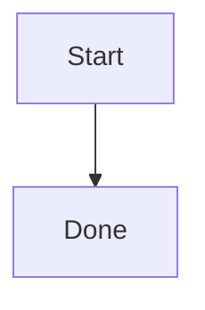

# Chapter 1: Create your first pipeline

This chapter creates a pipeline that starts immediately and ends successfully.
It introduces the pipeline file set without recognition or input actions.

## 1.1 Create the folder

Create a folder named `hello` below the user pipelines folder. The Settings
view lists this folder under **Related details** and can open it for you.

The finished source set is:

```text
hello/
├── hello.md
└── hello.meta.json
```

The base names must match. A layout file is optional and will be introduced in
Chapter 2.

## 1.2 Write the Mermaid graph

Create `hello.md`:

````markdown

````

`Start` and `Done` are stable node IDs. Text inside brackets is the displayed
label.

## 1.3 Write the metadata

Create `hello.meta.json`:

```json
{
  "nodes": {
    "Start": {
      "kind": "Entry"
    },
    "Done": {
      "kind": "Endpoint"
    }
  },
  "instances": {
    "Start": { "node": "Start" },
    "Done": { "node": "Done" }
  }
}
```

Entry and Endpoint nodes do not recognize images or execute actions. A valid
pipeline has exactly one Entry and at least one Endpoint.

## 1.4 Load and run it

1. Open the Pipeline view.
2. Select `hello/hello.md`.
3. Confirm that the graph shows Start and Done with their special node colors.
4. Start the pipeline.
5. Confirm that the status becomes **Completed**.

If loading fails, read the file and field diagnostic. WatchDog validates the
Mermaid graph and metadata before execution.

## 1.5 What you learned

- The `.md` file owns graph structure.
- The `.meta.json` file owns behavior.
- `instances` connect graph node IDs to metadata definitions.
- Endpoint completion is explicit.

Next: [Draw the pipeline graph](02-mermaid-graph.md).
