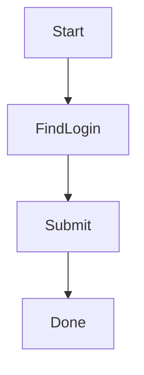
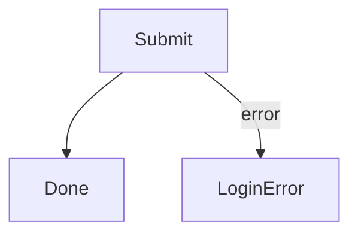
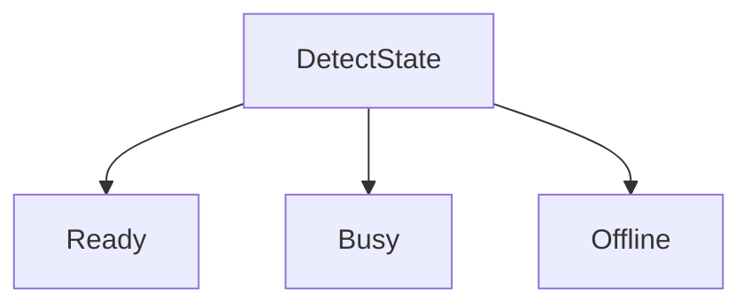
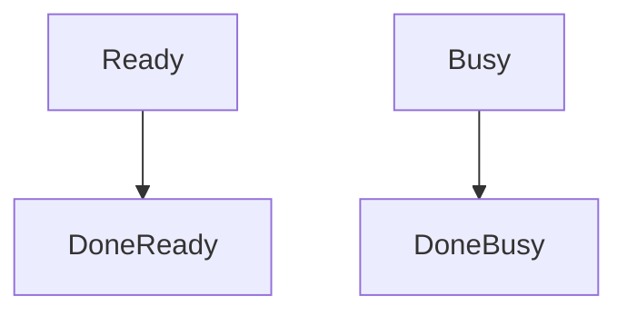

# Chapter 2: Draw the pipeline graph

The pipeline Markdown file contains a Mermaid `flowchart`. WatchDog preserves
this source when it saves graph edits.

## 2.1 Define nodes


Use short IDs without spaces. Labels may contain spaces and can change without
changing the metadata key when `instances` explicitly map the ID.

## 2.2 Add normal routes

An unlabeled arrow is a normal `next` route:



Execution begins at the Entry node. Normal nodes recognize their state, run
their actions, and then follow graph routing.

## 2.3 Add an error route

Use the exact `error` edge label:



The error edge is used when recognition times out or an action fails. A node
may have at most one error route.

## 2.4 Create fan-out candidates

Multiple normal outgoing edges create an ordered candidate list:



WatchDog tries candidates in Mermaid source order. The first eligible candidate
whose recognition matches becomes the route. Candidate nodes that exhaust
their own attempt conditions can be skipped while the parent fan-out remains
active.

## 2.5 Finish every successful route

Every successful path must reach an Endpoint:



Stopping at a normal node with no outgoing route is a pipeline failure. Add a
distinct Endpoint when separate outcomes should both count as successful.

## 2.6 Save visual positions

Dragging nodes changes presentation only. WatchDog stores shareable positions
in an optional sibling file:

```text
hello.layout.json
```

The layout never changes routing. See the
[layout reference](../pipeline-layout.md) for its schema.

Next: [Configure pipeline metadata](03-metadata-basics.md).
