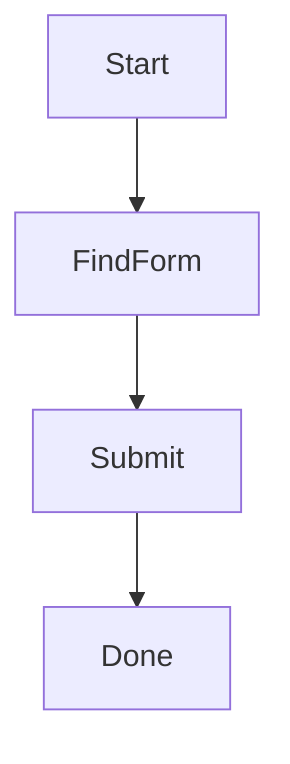
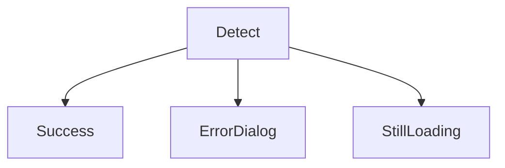
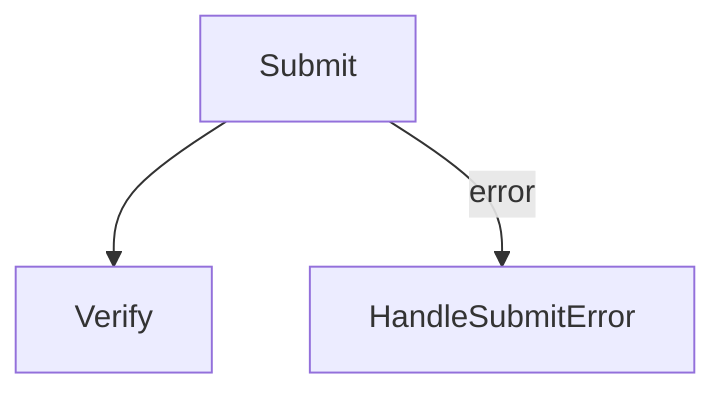
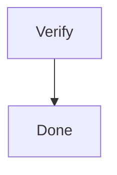

# Chapter 6: Route failures and complete runs

Pipeline behavior comes from the graph and each node's attempt limits. This
chapter separates normal routing, candidate routing, error recovery, and final
completion.

## 6.1 Normal routing

A successful normal node follows its outgoing normal route:



The engine owns the current node pointer. Recognition plugins and Patrol do not
advance it during ordinary execution.

## 6.2 Candidate fan-out

Multiple normal children are tried as an ordered group:



Put the most specific or most likely visual state first. Candidate order is
source order, so graph formatting is behavior here.

## 6.3 Error routing



An error edge handles recognition timeout or action failure. If no error edge
exists, that failure becomes terminal unless the node is currently being tried
as one candidate in a parent fan-out.

Error handlers should perform an action that can plausibly address the error.
A meaningless action may keep the graph valid while leaving the UI unchanged.

## 6.4 Completion and failure

An enabled Endpoint records a matched step and completes without capture,
recognition, or actions. A normal leaf is a failure:



```json
"Done": { "kind": "Endpoint" }
```

Each pipeline needs at least one Endpoint. Multiple Endpoints are allowed for
different successful outcomes.

## 6.5 Redirection creates a new execution epoch

An accepted Patrol redirect clears failure and child-routing state and resets
hit quotas for a new epoch. It retains run ID, step history, parameters,
capture identity, redirect count, and accepted-route history. The selected
node then runs through ordinary recognition and input safety.

Next: [Select and launch capture targets](07-targets-launch-capture.md).
