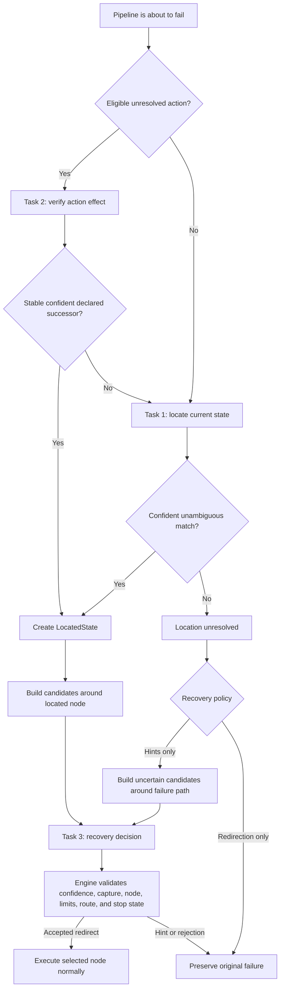

# Chapter 10: Add Patrol and recovery

Patrol is WatchDog's optional VLM observer and failure-recovery assistant. It
runs beside the pipeline, explains what it sees in the Patrol Chat Room, and
can provide a recovery hint or redirect a failed run after engine validation.
Periodic Patrol reports never control normal pipeline execution.

This tutorial uses the bundled `sample` and `patrol-redirection` pipelines on
Windows.

## 1. What you need

- A vision-capable model exposed through an OpenAI-compatible chat completions
  endpoint.
- The endpoint URL, model name, and API key, when the endpoint requires one.
- A pipeline with useful node descriptions and at least one `Endpoint` node.
- A selected screen or window capture target.

The endpoint must accept image parts in chat-completions messages and return
text. A local endpoint might use a URL such as:

```text
http://127.0.0.1:25555/v1/chat/completions
```

Use the complete chat-completions URL rather than only the server base URL.

## 2. Start the development applications

Build all three applications:

```powershell
npm install
npm run build:all-targets:debug
```

The resulting executables are:

```text
src-tauri\target\debug\watch-dog.exe
src-tauri\target\debug\watch-dog-tester.exe
src-tauri\target\debug\watch-dog-target.exe
```

Start `watch-dog.exe`. Bundled sample pipelines can launch
`watch-dog-target.exe` when they run.

## 3. Configure Patrol

Open **Settings → LLM / VLM Patrol** and enter:

| Setting | Suggested first value | Purpose |
| --- | ---: | --- |
| Enable Patrol | On | Enables periodic observation and failure analysis. |
| Patrol interval | `20` seconds | Starts the first periodic sample 20 seconds after the run begins. |
| Neighbor distance K | `1` | Searches the nearest graph states first. |
| State match threshold | `0.85` | Minimum confidence for locating the current visual state. |
| Action effect threshold | `0.85` | Minimum confidence for accepting a successor after an action. |
| Recovery redirect threshold | `0.85` | Minimum confidence before the engine can accept a redirect. |
| Minimum score margin | `0.10` | Required separation between the best two state candidates. |
| Failure recovery | **Hints only** | Safe starting policy that never changes routing. |
| Chat completions URL | Your endpoint | Full OpenAI-compatible endpoint URL. |
| Vision model | Your model name | Model identifier understood by the endpoint. |
| API key | Your key | Kept only for the current application session. |

The endpoint URL and model name persist. The API key does not persist and must
be entered again after restarting WatchDog.

Patrol has no record or enforce mode. It is either enabled or disabled.
Successful node visits automatically save run-scoped reference screenshots.
The first visits can still be matched from node descriptions when a reference
does not exist yet.

## 4. Understand the three VLM tasks

Patrol keeps each VLM request focused on one task.

### Task 1: Current State Matcher

Task 1 answers: **Which nearby pipeline node matches the current screen?**

It receives the current screenshot and up to 16 nearby candidate nodes. It
uses node descriptions and reference screenshots that already exist in the
current run. It does not receive action history.

### Task 2: Action Effect Verifier

Task 2 answers: **What visible result followed the dispatched action?**

It receives the exact frame from before the action, a newer frame from the
same target and capture session, the actions actually dispatched, and the
declared normal and error successors. Failed or blocked actions are not
claimed as executed.

Only a stable, sufficiently confident `expected_successor` or declared
`error_successor` result can establish the recovery location. Results such as
`unchanged`, `in_progress`, or `inconclusive` cannot establish it.

### Task 3: Recovery Advisor or Route Selector

Task 3 answers: **Which supplied node should the user consider or the engine
execute next?**

It receives one current screenshot, failure context, recent execution path,
the validated location, and bounded candidate descriptions and actions. It
does not receive Task 1 or Task 2's raw response, candidate reference images,
or the before-action frame.

## 5. Periodic and failure-time behavior

During normal execution, each Patrol cycle runs one task:

1. Task 2 runs when an unresolved eligible action has a newer frame.
2. Otherwise, Task 1 runs.
3. The report is observational and does not pause, stop, or redirect the
   pipeline.

At an impending pipeline failure, Patrol uses a validated handoff:



Task 2, Task 1 fallback, and Task 3 share one 45-second active-time budget.
Paused time does not consume this budget. Stopping the run cancels finalization.

## 6. Try a hint-only failure

1. Keep **Failure recovery** set to **Hints only**.
2. Load the bundled `sample` pipeline.
3. Start the pipeline against the Target application.
4. Deliberately enter an incorrect password so login fails.
5. Let the pipeline reach its terminal failure.
6. Open **Patrol Chat Room**.

The Execution Log should show a **HINT ONLY** entry. Routing remains unchanged
and the original pipeline failure stays visible. Expand the related Chat Room
messages to inspect:

- the action result;
- a Task 1 fallback when Task 2 could not establish location;
- the validated location or an unresolved-location diagnostic;
- the candidate list;
- the exact Task 3 response;
- the final hint and confidence.

The hint is advice for editing the pipeline or retrying manually. Patrol does
not execute it in this mode.

## 7. Try guarded redirection

The bundled `patrol-redirection` pipeline creates one harmless missed click.

1. Open **Settings → LLM / VLM Patrol**.
2. Select **Redirection only**.
3. Set **Maximum redirects per run** to `1`.
4. Load the bundled `patrol-redirection` pipeline.
5. Start the pipeline.

The pipeline launches the standalone Dashboard target and runs its Recovery
Test:

1. `ArmFirstMiss` arms one intentionally ignored click.
2. `ApplyRecovery` sends the click.
3. `VerifyRecovered` sees `Retry required` instead of `Recovered` and fails.
4. Patrol establishes the current location and asks Task 3 for one candidate.
5. If Task 3 selects `ApplyRecovery` with sufficient confidence and every
   engine guard passes, the engine redirects to that node.
6. The second click succeeds and the same run reaches its `Done` endpoint.

The Execution Log displays a **REDIRECT** tag and whether the proposal was
accepted or rejected. A redirect is rejected when any of these checks fail:

- location was unresolved;
- recovery confidence was below the redirect threshold;
- the capture target or session changed;
- the target was not an enabled normal node;
- the redirect limit was reached;
- the same failure-to-target route already ran;
- the user stopped the pipeline.

Starting at the selected node still uses ordinary recognition, foreground
activation, input safety, timeouts, and routing. Patrol does not execute raw
mouse or keyboard commands itself.

## 8. Read the Patrol Chat Room

The Chat Room is a read-only session timeline:

- **VLM messages appear on the left.**
- **Patrol operations appear on the right.**
- Related messages are grouped by run, capture session, and frame.
- Details are collapsed by default.
- Image previews load only after expanding a message.
- The run selector can show one run or all runs.
- **Clear session** removes the in-memory transcript and image previews.

Useful message types include:

| Message | Meaning |
| --- | --- |
| Action effect report | Task 2 classified the visible result of an action attempt. |
| Recovery location remains uncertain | Task 2 could not establish location, or Task 1 could not produce a confident match. |
| Validated recovery location | A qualified Task 2 result or Task 1 established `LocatedState`. |
| Prepared recovery candidates | Patrol built the bounded Task 3 candidate list around the location. |
| Recovery report ready | Task 3 returned a hint, redirect, no-recovery, or inconclusive decision. |

The normal Execution Log contains concise results. Use the Chat Room when you
need exact prompts, responses, scores, capture identity, stability, retries,
or rejection details.

## 9. Write Patrol-friendly pipelines

Patrol works best when metadata explains visual state and action intent:

```json
{
  "nodes": {
    "ApplyRecovery": {
      "desc": "Click Apply recovery. If the screen reports Retry required, executing this node again resolves the missed action.",
      "recognition": {
        "type": "OCR",
        "expected": "Apply recovery",
        "threshold": 0.6
      },
      "actions": [{ "type": "Click" }]
    },
    "VerifyRecovered": {
      "desc": "Verify that the Recovery Test status changed to Recovered. Retry required means the previous click was missed.",
      "recognition": {
        "type": "OCR",
        "expected": "Recovered",
        "threshold": 0.6
      }
    }
  }
}
```

Use these guidelines:

- Describe what should be visibly true at each node.
- Explain what an action is intended to change.
- Declare visual error successors when an error state is expected.
- Keep recovery candidates as enabled normal nodes with meaningful actions.
- Use `Endpoint` nodes for successful termination.
- Keep recognition regions focused so the pipeline itself remains the primary
  and deterministic workflow driver.

Patrol settings belong in the Settings View. Do not add Patrol configuration
to pipeline metadata.

## 10. Troubleshooting

### `Patrol VLM connection failed`

- Verify the endpoint process is running.
- Confirm that the URL includes `/v1/chat/completions` when required.
- Confirm that the endpoint is reachable from WatchDog.
- Re-enter the API key after restarting the application.

Connection errors, HTTP 429, and HTTP 5xx responses retry once after 500 ms.
Three consecutive transport failures open a per-run circuit and stop periodic
requests. Failure finalization is allowed one final probe.

### `Patrol finalization deadline expired`

The failure-time sequence exceeded its shared 45-second active budget. Use a
faster model or endpoint. The original pipeline failure remains authoritative.

### State matching is inconclusive

- Improve node descriptions.
- Let successful visits create references in the current run.
- Check that visually similar nodes have distinct descriptions or recognition
  regions.
- Lower the state threshold cautiously.
- Reduce the minimum margin only when the top two candidates are legitimately
  similar.

### Task 2 says `unchanged` or `in_progress`

The action may have been ignored, the application may still be loading, or
the selected after-frame may not yet show a stable transition. Add appropriate
`post_wait_freezes` when the UI has a reliable settled state. Task 2 does not
establish recovery location from either result, so failure finalization falls
back to Task 1.

### Redirect was rejected

Expand the recovery report in the Chat Room and read the engine diagnostic.
Do not lower confidence thresholds until capture identity, node eligibility,
route history, and the proposed node's actions have been checked.

## 11. Privacy and stored evidence

Patrol sends screenshots, node descriptions, and sanitized action summaries to
the configured endpoint. It excludes the API key from events and logs. Input
text and arbitrary character keys are represented by counts; custom action
parameters are excluded.

Reference screenshots are stored per run under the Patrol visions directory.
The Settings **Related details** section shows the folder and provides a button
to open it. Chat Room previews use a bounded in-memory cache and may become
unavailable after eviction or after clearing the session.

Next: [Record actions and receive notifications](11-recorder-and-notifications.md).
